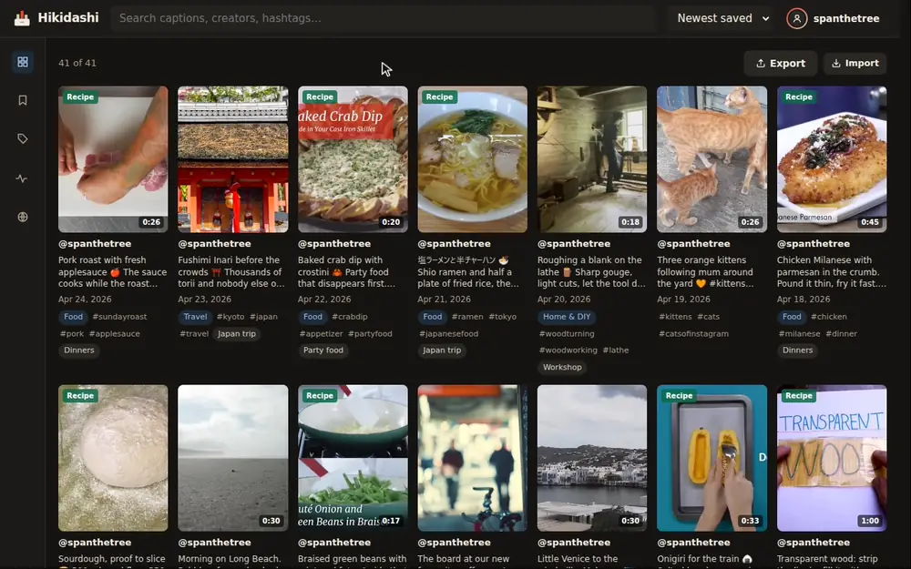
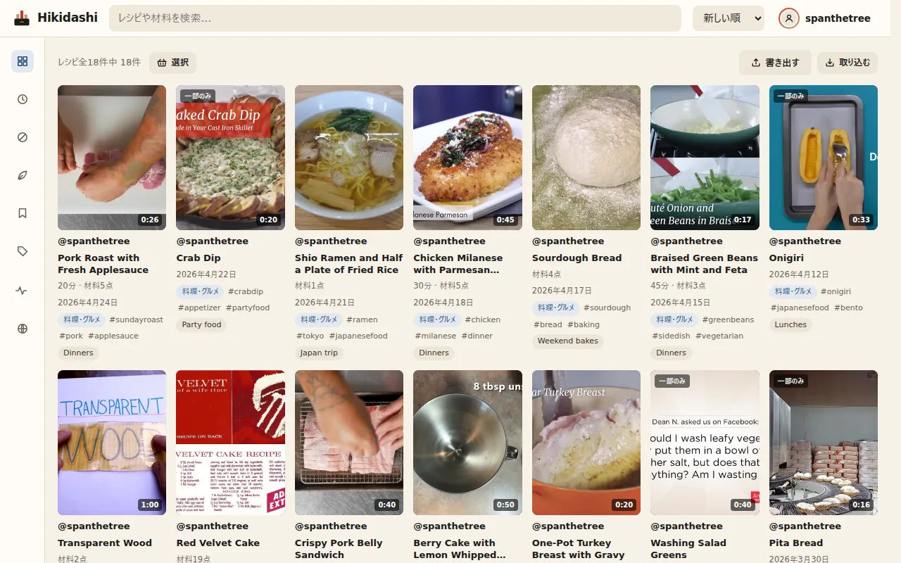
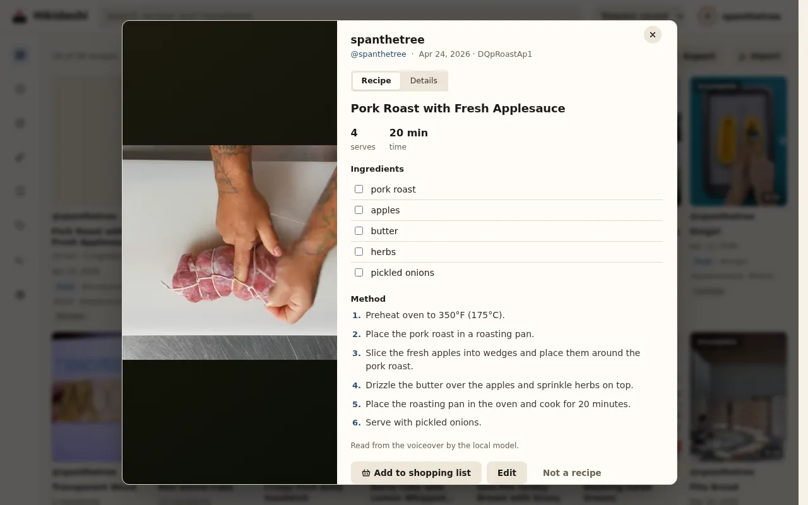
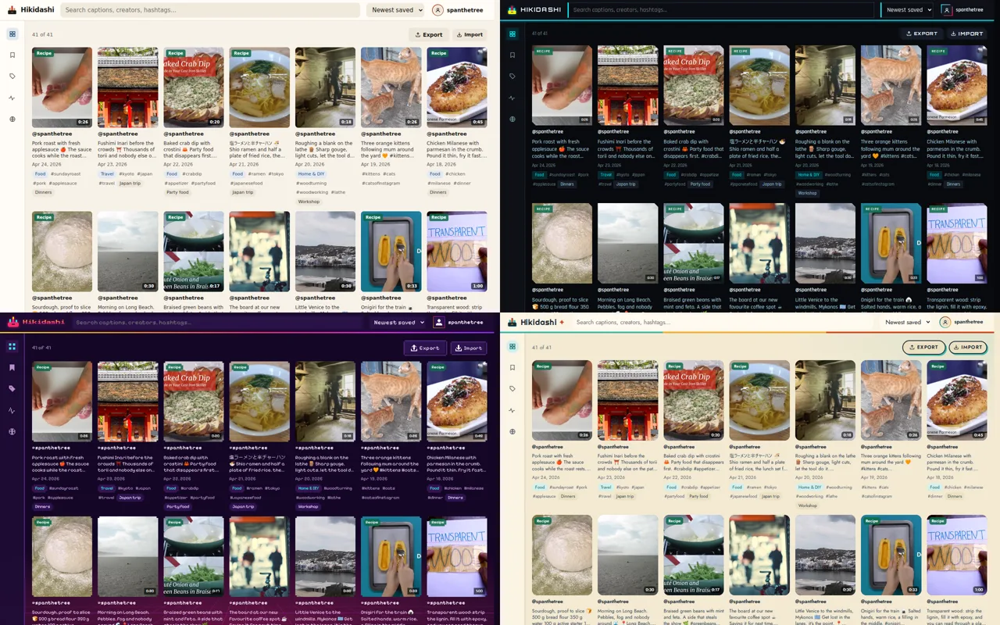

<div align="center">

<picture>
  <source media="(prefers-color-scheme: dark)" srcset="docs/brand/wordmark-dark.svg">
  
</picture>

**Instagram の保存済み投稿を、検索できる自分だけのライブラリに。セルフホスト型。**

[](https://github.com/spanthetree/hikidashi/releases)
[](https://github.com/spanthetree/hikidashi/actions/workflows/tests.yml)
[](LICENSE)

[English](README.md) · **日本語**

[はじめに](#はじめに) ·
[ドキュメント](docs/README.md) ·
[FAQ](docs/faq.md) ·
[変更履歴](CHANGELOG.md) ·
[コントリビュート](CONTRIBUTING.md)

</div>

Instagram の「保存済み」は検索のできないグリッドです。Hikidashi はデータのエクスポートを読み込み、リールを一本ずつ手元に保存し、話している内容・画面上の文字・何についての動画かをまとめて索引にします。うろ覚えのあのリールも、すぐに見つかります。すべて自分のマシン上で、ローカルのモデルで動きます。



<sub>自由ライセンスの素材によるデモ用ライブラリで録画（[クレジット](docs/demo/CREDITS.md)）。[より長いツアー](docs/demo/tour.mp4)もあります。</sub>

## 主な機能

- **意味で検索。** キャプション、文字起こし（[faster-whisper](https://github.com/SYSTRAN/faster-whisper)）、画面上の文字（Tesseract）を、キーワードと意味の両方で横断検索します。「ベジタリアンのサンドイッチ」で *Portobello banh mi* というキャプションのリールが見つかります。
- **タグと要約。** ローカルモデル（[Ollama](https://ollama.com)）が各リールをカテゴリに分類し、要約を付けます。ゲームのリールには、映っているゲームのタイトルも付きます。自分で付けたタグが常に優先されます。
- **レシピ。** 料理のリールは材料リストと手順になり、調理時間や材料で絞り込めます。複数のレシピを売り場ごとにまとめた買い物リストも作れます。
- **地図で見る保存スポット。** キャプションに出てくるお店や観光地を一覧にし、地図に表示します（ジオコーディングは任意）。
- **手元にコピーを保存。** 動画とサムネイルをダウンロードするので、元の投稿が消えても残ります。
- **エクスポート。** レシピは Mealie・Tandoor・Paprika へ。ライブラリ全体は Obsidian の Vault、JSON、CSV で書き出せます。
- **複数ユーザー。** 一台のサーバーで、ユーザーごとに別々のライブラリを持てます。スクリプト用の API トークンもあります。
- **自動処理。** 新しい保存はバックグラウンドでダウンロード・解析されます。重い処理は GPU のある別のマシンに任せることもできます。
- **日本語と英語の UI**、ライトとダークのテーマ。

| | | |
|---|---|---|
|  |  |  |
| 日本語の UI | ナレーションから読み取ったレシピ | 4つのテーマとピクセルアート |

## プライバシー

ライブラリは自分のマシンから出ません。Hikidashi が Instagram に接続するのは保存した投稿をダウンロードするときだけで、モデルのダウンロードも最初の一度だけです。地図を有効にした場合は、地名をジオコーダーに送り、地図タイルを読み込みます。どちらもセルフホストできます。Instagram のパスワードを求めることはありません。

ホスト型AIは任意で、初期状態はオフです。あなたや管理者がAPI（OpenAI、Groq の無料枠、または自分で立てた OpenAI 互換サーバー）をオンにすると、そのAPIが処理するリールの音声、数枚のフレーム、テキストがそのプロバイダーに送られます。キーは暗号化して保存され、二度と表示されません。詳しくは[何がどこへ送られるか](docs/operation.md#hosted-ai)を参照してください。

## はじめに

**1. エクスポートをリクエストする。** Instagram の[アカウントセンター](https://accountscenter.instagram.com/info_and_permissions/dyi/)で「情報をエクスポート」（Export your information）を開き、デバイスへのエクスポートを作成します。**保存済み**（Saved）のみ、期間は**全期間**（All time）、形式は **JSON** を選んでください。たいてい1時間以内に届きます。

**2. Docker で Hikidashi を起動する。**

```bash
git clone https://github.com/spanthetree/hikidashi.git && cd hikidashi
./hikidashi --docker start --ai
```

公開済みのイメージを取得し、サーバー、バックグラウンドのワーカー、Ollama を起動します。uv でソースから動かす場合は[インストール](docs/install.md#with-uv)を参照してください。

**3. 読み込む。** <http://localhost:8080> を開き、エクスポートの ZIP をページにドロップします。キャプションはすぐに検索でき、文字起こし・タグ・レシピはワーカーの処理が進むにつれて追加されます。

### NAS で動かす

- **Unraid:** テンプレートまたは Compose Manager。[Unraid へのインストール](docs/install-unraid.md)を参照。
- **TrueNAS SCALE:** YAML ファイル一つ。[TrueNAS SCALE へのインストール](docs/install-truenas.md)を参照。

### 省電力のデバイスで動かす

小型の NAS や ARM ボードでは、ワーカーのコンテナと Ollama を使わず、サーバーだけを動かせます。チェックアウトしたフォルダの `.env` に次の一行を書き、`--ai` を付けずに起動します。

```bash
COMPOSE_FILE=docker-compose.yml:docker-compose.server-only.yml
```

```bash
./hikidashi --docker start
```

新しいリールのダウンロードと、キャプションと意味による検索はサーバーだけで動きます。文字起こし・画面上の文字・タグ・レシピは、別のマシン（できれば GPU 付き）のワーカーが動いたときに処理されます。[リモートワーカー](docs/remote-workers.md)を参照してください。

### 動作環境

Docker と Compose、またはソースから動かす場合は Python 3.12・uv・FFmpeg・Node 22.17 以降。CPU だけでも動きますが、NVIDIA の GPU があると文字起こしとタグ付けがずっと速くなります（[ハードウェアプロファイル](docs/pipeline.md#hardware-profiles)）。

**文字起こしは今のところ英語のモデルのみです。** 日本語の音声はうまく文字にならないことがありますが、日本語のキャプションと画面上の文字は検索できます。日本語で検索すると、同じ話題の英語のリールも見つかります。

## ドキュメント

ドキュメントは英語です。

| | |
|---|---|
| [FAQ](docs/faq.md) | パスワード、プライバシー、ハードウェア、言語 |
| [Installing](docs/install.md) | Docker または uv、読み込み、アップデート |
| [Using Hikidashi](docs/using.md) | 検索、レシピ、地図、パイプライン画面 |
| [Configuration](docs/configuration.md) | すべての設定とその既定値 |
| [Accounts and access](docs/accounts.md) | 複数ユーザー、認証プロキシ、API トークン、HTTPS |
| [Exports](docs/export.md) | レシピ管理アプリ、Obsidian、JSON、CSV |
| [Remote workers](docs/remote-workers.md) | 重い処理を別のマシンで動かす |

すべてのドキュメントは [docs/](docs/README.md) にあります。

## 開発状況

Hikidashi は 1.0 に向けて開発中です。リリースごとにデータベースは自動で移行され、アップデート時に注意が必要なことは[変更履歴](CHANGELOG.md)に記載します。読み込みは今のところ Instagram の手動エクスポートからで、継続的な同期は[今後の課題](https://github.com/spanthetree/hikidashi/issues/9)です。

## コントリビュート

バグ報告、アイデア、翻訳、プルリクエストを歓迎します。[CONTRIBUTING.md](CONTRIBUTING.md) を参照してください。セキュリティの問題は [SECURITY.md](SECURITY.md) の方法で非公開で報告してください。

## ライセンス

Hikidashi は [PolyForm Noncommercial License 1.0.0](LICENSE) のもとでソースを公開しています（ソースアベイラブル）。個人利用、研究、非営利団体や公的機関での利用を含め、非営利の目的であれば無料で利用・改変・共有できます。商用利用には別途ライセンスが必要です。このライセンスを選んだ理由は[決定記録 0016](docs/adr/0016-polyform-noncommercial.md)（英語）にあります。

使用しているモデルやプログラムにはそれぞれのライセンスがあり、一部は非商用に限られます。[THIRD_PARTY.md](THIRD_PARTY.md) を参照してください。

Hikidashi は Instagram および Meta とは一切関係がなく、承認や後援を受けたものではありません。
