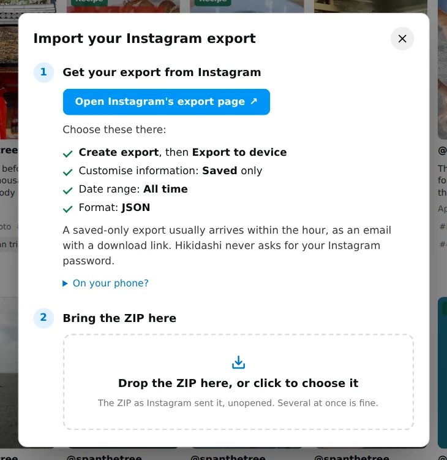

<div align="center">


# Hikidashi

**A self-hosted, searchable library for your Instagram saves.**

Runs on your machine · local models · your data stays yours · one library each

[](CHANGELOG.md)
[](https://github.com/spanthetree/hikidashi/actions/workflows/tests.yml)
[](CHANGELOG.md)
[](LICENSE)
[](#quick-start)
[](#quick-start)

[Features](#features) ·
[Quick start](#quick-start) ·
[Using it](#using-it) ·
[Sharing it](#sharing-it-with-others) ·
[Configuration](#configuration) ·
[Docs](#documentation) ·
[License](#license) ·
[Changelog](CHANGELOG.md)

</div>

Instagram's Saved screen gives you an endless grid with no search, no tags and
no way to find the reel you half remember. Hikidashi imports your data export
into a local SQLite library, downloads each reel, and makes the whole archive
searchable by what the video is actually about: what's said in it, what's
written on screen, and what it shows.


<sub>A real recording, on a demo library of freely licensed clips and photos ([credits](docs/demo/CREDITS.md)). A longer tour, with more searches, a shopping list, a collection and the workers: [docs/demo/tour.mp4](docs/demo/tour.mp4).</sub>

## Features

- 🔎 **Search by meaning, not just words.** Captions, spoken words
  ([faster-whisper](https://github.com/SYSTRAN/faster-whisper) transcripts) and
  on-screen text (tesseract OCR) share one full-text index, blended with
  semantic search. "Warm broth for a cold night" finds a reel captioned
  *Loaded Potato Soup*, and "the one where she says soup doesn't count as a
  meal" finds the reel that said it.
- 🏷️ **Automatic tags and summaries.** A local LLM via
  [Ollama](https://ollama.com) files every reel under one category and writes a
  one-line summary and keywords, falling back on its hashtags. Cleaned hashtags
  and keywords are searchable and filterable. A gaming reel also gets the
  video game it shows, when its own text names it, or a question to confirm
  it. Your own choice always wins.
- 🍳 **Recipes, extracted.** Recipe reels are detected and turned into
  ingredient checklists and numbered steps, checked against the reel's own
  text. Filter by time, by ingredient, or by what a recipe leaves out: "with
  chicken, without dairy".
- 🛒 **A shopping list.** Put several recipes on one shopping list, merged and
  sorted by aisle, and tick it off in the shop. To cook from a recipe, export
  it to Mealie or Tandoor.
- 🎬 **Your own copy.** Thumbnails and original mp4s are downloaded with
  [yt-dlp](https://github.com/yt-dlp/yt-dlp), so a save outlives the post.
- 📍 **Your saved places, on a map.** Addresses and 📍 pins in captions become
  Google Maps links, and **Places** gathers every reel that names one. Flip it
  to a map to see every restaurant, shop and viewpoint you've saved, filtered
  like the grid: search "ramen" and see the ramen places. Use Near me, or type
  a city, to sort them by distance. Looking places up is opt-in; see
  [Maps](#maps).
- 📦 **Take it with you.** Export recipes as schema.org JSON-LD, or as files
  Mealie, Tandoor and Paprika import, and the whole library as an Obsidian
  vault of linked Markdown notes, or as JSON and CSV. See
  [Taking it elsewhere](#taking-it-elsewhere).
- ⚙️ **New saves process themselves.** Workers beside the server run every
  stage on new reels as they arrive, each once the stages before it are done.
  Kill one at any point and nothing is lost; a reel that keeps failing is set
  aside after three tries. Keep a small box serving the library and run the
  heavy stages on a GPU desktop, left on or by hand. See
  [The worker](docs/pipeline.md#the-worker) and
  [A NAS and a GPU desktop](#a-nas-and-a-gpu-desktop).
- ♻️ **Resumable everything.** Every stage works item by item and can be killed
  and re-run at any point without losing progress or redoing work.
- 🔗 **Every view is a URL.** Search, filters and the open reel live in the
  address bar, so any view can be bookmarked and the back button works.
- 👥 **One server, a library each.** With accounts on, everyone signs in and
  sees only their own saves. A reel two people saved is downloaded,
  transcribed and tagged once, and their tags, collections and recipe edits
  stay their own. Scripts and assistants get in with an API token, scoped to
  what you tick and to your library alone.
- 🌐 **English and 日本語.** The UI follows your browser's language, or the
  switcher at the foot of the sidebar. Japanese searches find Japanese captions
  and, through the multilingual embeddings, English reels on the same subject.
- 🎨 **Themes, light or dark, and pixel art.** Instagram by default, plus
  cyberpunk, retrowave and retrofuture, each with its own fonts and motion.
  Light, dark, or whatever your system uses, and a pixel-art switch that
  redraws any of them in pixels.

Everything runs locally. The only network traffic is fetching your saved posts
from Instagram and downloading model weights once, and, if you turn the map on,
looking up places and drawing map tiles.

## Quick start

You need **Docker**, or **[uv](https://docs.astral.sh/uv/)** with Python 3.12+,
ffmpeg, and Node 20+ to build the web UI. Tesseract (for OCR) and Ollama
(for tagging and recipes) are optional; under Docker the worker image has
tesseract, and `--ai` starts Ollama.

**1. Get your Instagram export.** Open
[**Export your information**](https://accountscenter.instagram.com/info_and_permissions/dyi/)
in Accounts Centre (or in the app: **Accounts Centre** → *Your information and
permissions* → *Export your information*), then **Create export** → *Export to
device*. Choose **Saved** only, **All time**, and format **JSON**. A saved-only
export usually arrives within the hour.

**2. Start Hikidashi.**

```bash
./hikidashi --docker start --ai          # Docker, with Ollama for tagging
# or
uv sync --extra server --extra worker && ./hikidashi start   # uv
```

`./hikidashi` runs under Docker once its container exists, and under uv
otherwise, so the first Docker start says `--docker`. After that it finds the
container on its own. Docker pulls the published images from
`ghcr.io/spanthetree`; `--build` builds them from the checkout instead.

**3. Import.** Open <http://localhost:8080>. A new library opens on the
import box: drop the ZIP on it, or click (or tap, on a phone) to choose it.
Later, **Import** in the toolbar opens the same box, and a ZIP dropped
anywhere on the library goes in too. Several ZIPs import one after another,
each with an upload bar and its counts. Or run
`./hikidashi import data/imports/export.zip`. Under Docker the ZIP must be in
the data folder, which the container sees; under uv any path will do. Search
works straight away on captions.



**4. Let it work.** The workers that `start` runs download, transcribe,
read, tag and embed every new reel on their own: one worker under uv, and
under Docker two, `server-worker` (fetch and embed) and `worker` (transcribe,
read, tag and find recipes). Watch it on the **Pipeline**
page (from the sidebar) or with `./hikidashi status`. Tagging and recipes need
Ollama, which the worker calls: `--ai` under Docker, or your own, at
`HIKIDASHI_OLLAMA_URL` under Docker and `OLLAMA_URL` under uv. The server never
calls it.

To run every stage over everything once instead, as from cron:

```bash
./hikidashi pipeline
```

### On Unraid or TrueNAS SCALE

A NAS installs Hikidashi from the published images through its own UI, with
no checkout:

- **Unraid:** a template per container, from
  [`deploy/unraid/`](deploy/unraid/), all on one Data folder on a pool. Or
  Compose Manager, with its stack on a folder in
  [`deploy/unraid/compose-manager/`](deploy/unraid/compose-manager/). A
  library already on another machine moves over as files.
  [Installing on Unraid](docs/install-unraid.md).
- **TrueNAS SCALE:** one compose file,
  [`deploy/truenas/hikidashi.yaml`](deploy/truenas/hikidashi.yaml), pasted
  into *Install via YAML*. [Installing on TrueNAS SCALE](docs/install-truenas.md).

Both run the containers as the NAS's own user, so the data isn't
root-owned. The published images are still to come (#77). Until then,
Unraid's Compose Manager builds them on the box.

### Managing the server

```bash
./hikidashi status       # server, workers, counts per stage, which models are ready
./hikidashi logs -f      # the server's log; `logs worker` or `logs server-worker` for one
./hikidashi stop         # the server and the workers
./hikidashi start        # all again; Docker: --ai to start Ollama too
./hikidashi restart      # all, with any changes to .env
```

`./hikidashi` uses Docker or uv, whichever is set up, and needs no Python on
the host. `./hikidashi <command> --help` lists every command's flags.

### Updating

```bash
git pull && ./hikidashi start                     # Docker: pull the images, then recreate
git pull && uv sync --extra server --extra worker && ./hikidashi restart   # uv
```

Add `--ai` to the Docker line if you run the bundled Ollama. Under uv, the web
UI rebuilds itself. Name both extras every time: `uv sync` removes what the
command line leaves out, and a bare `uv sync` has no server. The database
catches up with a new version on its own, and the workers re-run only the
stages whose version changed. [CHANGELOG.md](CHANGELOG.md) lists what changed.

**From Docker to uv** on the same machine, with the same data:

```bash
docker compose --profile ai down          # removed, or ./hikidashi still picks Docker
sudo chown -R "$(id -un)" data            # the containers wrote it as root
uv sync --extra server --extra worker && ./hikidashi start
```

The bundled Ollama's port is not published, so the uv worker needs an Ollama
of its own at `OLLAMA_URL` (`localhost:11434` unless set). To keep the models
already pulled, run the same volume with the port published:
`docker run -d --name ollama -p 127.0.0.1:11434:11434 -v hikidashi_ollama-models:/root/.ollama ollama/ollama`.

## Using it

- **The sidebar** is a rail of icons that opens when you hover it; the pin at
  its top keeps it open.
- **The grid** filters by tag, game, collection, hashtags and search, all at
  once: each one you choose narrows the rest. Tags, games, collections and
  hashtags on a reel are clickable, each showing more of the same.
- **Videos** and **Images**, under Library in the sidebar, narrow whatever you
  are looking at (a collection, a tag, Recipes) to reels or to photo posts.
- **Open a reel** to watch it (muted and looped), read its transcript and
  on-screen text, edit its tags, confirm or name the game a gaming reel
  shows, and follow any addresses to Google Maps.
- **Places**, in the sidebar, shows only reels whose caption names a place.
  **Map** puts them on a map; see [Maps](#maps).
- **Recipes**, in the sidebar, shows only recipe reels, each led by the dish and
  how long it takes. Open one for an ingredient checklist next to the video, with
  **Add to shopping list**, **Edit**, **Use the model's version** and
  **Not a recipe**.
- **Select**, in Recipes, picks several recipes for the shopping list; with a
  filter on (a collection, a search), **Add all** adds every one it shows.
  **Shopping list**, in the sidebar, merges their ingredients by aisle, folds
  away pantry staples, and can be shared or copied as text.
- **Remove** a reel from your library from its sheet. Anyone else who saved it
  keeps it; once nobody has, its video and thumbnail are deleted.
- **Try fetching again** on a reel whose fetch failed. Anyone who has the reel
  saved can, since a fetch that works, works for everyone who has it.
- **Pipeline**, from the worker's status in the sidebar, shows each worker
  and what every stage has ready, waiting, in hand and failed, with **Retry**
  for the failures. It also makes the tokens that let a worker on another
  machine work for this server. **Logs**, from there, shows the server's and
  the workers' logs live, filterable to warnings and errors. Admins only, once
  there are accounts.
- **The menu at the top right** picks the theme, light, dark or system, and
  pixel art, remembered in this browser. It also leads to **your account**,
  which holds your Instagram @handle, your password, and the export form;
  admins invite people and manage accounts there.
- **Export**, above the grid, downloads what it shows, and on a reel's sheet,
  that reel: as recipes for Mealie, Tandoor or Paprika, as Markdown, or as
  JSON or CSV.

## Sharing it with others

Out of the box nobody signs in: whoever opens the server is the library's
owner, exactly as on localhost. To give each person a library of their own,
set `HIKIDASHI_AUTH=local` and restart. Everything already imported stays
yours.

1. **Claim the library.** Run `./hikidashi user passwd local` and pick a
   password, then sign in as `local` (`./hikidashi user rename local <name>`
   picks another name). Or open the `/setup?token=…` link the server prints
   to its log at startup while nobody can sign in.
2. **Invite people.** There is no sign-up. On **Your account**, make a
   one-time link (or run `./hikidashi user invite --url https://your.host`)
   and send it. Each link makes one account and lasts 7 days.
3. **Everyone imports their own export**, from the web page or with
   `./hikidashi import --user <name> export.zip`.

Instagram login isn't offered: it needs Meta's App Review, and the API that
worked for personal accounts was shut down in December 2024. Your @handle on
your account is yours to state, and never checked.

Put it behind HTTPS before it leaves your network: set `HIKIDASHI_ORIGIN` to
the public address, which also marks the sign-in cookie Secure.

On your own network, plain HTTP (`http://192.168.1.20:8080`) works, with two
limits, because browsers keep some things to HTTPS pages: the map's **Near
me** can't find you, and the copy buttons fall back to an older way of
copying. If the browser refuses that too, the button says so and selects the
text for you to copy.

### From a script: API tokens

Anything that isn't a browser, such as a script, a monitor or an assistant,
signs in with an API token. Make one on **Your account** under **API tokens**:
name it, tick what it may do, and pick how long it lasts, 30 days at most.
It's shown once.

```sh
curl -H "Authorization: Bearer hk_api_…" https://your.host/api/stats
```

A token acts as you and reads only your library. `read:library` only reads
it, and `write:library` may change it too. Admins can also give `read:admin`
or `write:admin`, for the Pipeline page, logs and accounts. A token can't
change a password or make another token, and can't be extended: make a new
one. Admins see everyone's tokens on the **Pipeline** page and can revoke any.
On a server with no browser at hand:

```sh
./hikidashi token make monitor --user alice --scope read:library --days 7
./hikidashi token list
./hikidashi token revoke 3
```

Worker tokens, for a [GPU desktop](#a-nas-and-a-gpu-desktop), are a separate
kind: only admins make them, they open the worker routes and nothing else,
and they last until revoked.

**Already run Authelia, Tailscale or Cloudflare Access?** Set
`HIKIDASHI_AUTH=proxy` and Hikidashi takes the user from the proxy's
`Remote-User` header (`HIKIDASHI_PROXY_HEADER`). It believes the header only
from `HIKIDASHI_TRUSTED_PROXIES`, so make sure nothing else can reach the
port: from any other address, anyone could send one. Names with no account
are refused unless `HIKIDASHI_PROXY_CREATES=1`.

## How it works

Each saved post moves through eight stages. The workers run stages 2 to 7 as
reels arrive, and the server finds places itself. Under Docker, `server-worker`
runs 2 and 7 from the server image, and `worker` runs 3 to 6 from the worker
image. Each stage can also be run on its own, in the container with its tools,
and `./hikidashi pipeline` runs them all in order:

| | Stage | Command | What it does |
|---|-------|---------|--------------|
| 1 | Import | `import` | Reads the export: captions, creators, hashtags, collections |
| 2 | Enrich | `enrich --media` | Downloads metadata, thumbnails and mp4s with yt-dlp |
| 3 | Transcribe | `transcribe` | Speech to text with faster-whisper, skipping music-only reels and the stock phrases Whisper writes over them |
| 4 | OCR | `ocr` | Reads on-screen text from photos and reels with no speech |
| 5 | Tag | `tag --llm` | Hashtag mapping, then a local LLM for summaries and categories |
| 6 | Recipes | `recipe` | Finds recipes and extracts ingredients and steps |
| 7 | Embed | `embed` | Vectors for semantic search (embeddinggemma-300m) |
| 8 | Places | `places` | Reads places from captions, and puts them on the map |

Only fetching is expensive to redo; every later stage works on files already on
disk. Stages are versioned, so improving one only re-runs that one. See
[docs/pipeline.md](docs/pipeline.md) for each stage in depth.

### On a real library

Measured against **420 saves — 335 reels and 85 photo posts — across 7
collections**:

| | |
|---|---|
| Captions | 420 / 420, straight from the export |
| Videos | 322 of 335 reels, 3.5 GB, ~8 minutes |
| Transcripts | 224 videos, 4.4 hours of audio in 5 minutes on an RTX 3080 |
| On-screen text | 115 of the 187 items with no speech, in 30 seconds on CPU |
| Model tagging | 411 reels in 5.6 minutes on an RTX 3080 (`qwen2.5:7b`), 0 failures |
| Untagged items | 171 from hashtags alone → 25 after the model and OCR |
| Unfetchable | 9, restricted or login-only posts |

### Hardware

`HIKIDASHI_PROFILE` picks models to suit the machine. `auto` uses the GPU if it
can see one.

| Profile | Speech model | Tagging model | Speed |
|---------|--------------|---------------|-------|
| `cpu` | `distil-small.en` | `qwen2.5:3b` | ~25× realtime on 28 threads |
| `cuda` | `distil-large-v3` | `qwen2.5:7b` | ~50× realtime on an RTX 3080 |

For the GPU path, add `--extra cuda` to `uv sync`, or under Docker set
`HIKIDASHI_WORKER_IMAGE=hikidashi-worker-cuda` and uncomment the worker's GPU
block in `docker-compose.yml`. See
[hardware profiles](docs/pipeline.md#hardware-profiles) for details.

Under Docker there are two images. `hikidashi-server` has the web UI, the
API, yt-dlp and the embedder, and runs the `app` and `server-worker`
containers; `hikidashi-worker` (or `hikidashi-worker-cuda`) has Whisper and
tesseract, and runs `worker`. Ollama is the upstream `ollama/ollama`. The
server never calls it. See [In Docker](docs/pipeline.md#in-docker) for what
runs where.

### A NAS and a GPU desktop

The GPU doesn't have to be on the server. An always-on box, such as a NAS,
serves the library, fetches new reels and embeds them, while a desktop with a
GPU transcribes, reads, tags and finds recipes for it, either left running or
whenever you run it. New reels are searchable on the NAS meanwhile: by caption
at once, and by meaning too, embedded from their captions and again as the
desktop's transcripts and summaries arrive.

On the NAS, under Docker, pick how much it does itself, in `.env`:

```sh
# nothing heavy: app and server-worker only, and the worker image never built
COMPOSE_FILE=docker-compose.yml:docker-compose.server-only.yml
# or also transcribe and read on its CPU while the desktop is off
HIKIDASHI_LOCAL_STAGES=asr,ocr
```

Make a worker token for the desktop on the **Pipeline** page (or on the
server, `./hikidashi token make desktop --worker`). Then on the desktop:

```sh
uv sync --extra worker --extra cuda    # Whisper and the GPU libraries

# left running: works whenever there is work. Asks for the token, hidden.
uv run hikidashi worker --server http://nas.lan:8080

export HIKIDASHI_SERVER=http://nas.lan:8080
./hikidashi pipeline       # or by hand: transcribe, read, tag and find recipes, then exit
./hikidashi transcribe     # or one stage: ocr, tag and recipe too
```

The profile is `auto`, the GPU when there is one, and Ollama is this
machine's; `--profile` and `--ollama-url` (or `HIKIDASHI_PROFILE`,
`OLLAMA_URL`) change them. The token is never a flag: set
`HIKIDASHI_WORKER_TOKEN`, or type it when asked. By hand, each command claims
what the server has ready, sends back what it found, and exits; commands that
belong on the server, such as `enrich`, say so there. Under Docker on the
desktop, `docker-compose.worker.yml` runs the worker image, the cuda one by
default, left running with `up -d`, or by hand with `docker compose -f
docker-compose.worker.yml run --rm worker hikidashi pipeline`. See [remote
workers](docs/remote-workers.md).

## Maps

**Places**, under Library in the sidebar, lists every reel whose caption names
a place, and **Map** draws them: pins beside a list that narrows as you pan,
with the reel's thumbnail a click away. **Restaurants** and **Travel** under
it narrow both to the reels tagged Food or Travel. Every filter applies, and
where the map looks is in the URL, so a map view can be bookmarked.

The list needs nothing more than `./hikidashi places`. The map needs the places
looked up, which sends their text to a geocoder, so it is off until you choose
one. Set it in `.env` and restart the server:

```bash
HIKIDASHI_GEOCODER=public                  # OpenStreetMap's Nominatim, 1 place a second
HIKIDASHI_GEOCODER=http://nominatim:8080   # or your own
```

From then on the server keeps the map up to date by itself: it looks up the
places new reels name as they arrive, straight away for an import through the
web, and within five minutes (`HIKIDASHI_LOCATE_EVERY`) for one from the
command line. `./hikidashi places` does the same on demand, and
`HIKIDASHI_GEOCODER=public ./hikidashi places` tries a geocoder out for one
run. In Docker, `localhost` is the container itself: point at your own
Nominatim by its compose service name or `host.docker.internal`.

Each place is looked up once and remembered. Places the geocoder is unsure of
stay off the map rather than land in the wrong country; the map says how many
it leaves out. With a geocoder set, the map can also find a city you type.

**Map tiles leave your machine.** The browser draws the map from
OpenStreetMap's tile servers by default, which see the area you look at. Point
`HIKIDASHI_TILES` at a tile server of your own to keep that local too, and set
`HIKIDASHI_TILES_ATTRIBUTION` to the credit its data requires.

## Taking it elsewhere

**Your account** has an export form: a format, what to export (everything,
recipes, a collection or a tag), and for an admin, whose library. **Export**
above the grid exports what it shows, and on a reel's sheet, that reel.
`./hikidashi export` writes the same on the server:

> **Into Mealie, use Migrations, not Backups.** On Mealie's *Data Migrations*
> page, choose *Nextcloud Cookbook* for the ZIP, or *Paprika* for the
> `.paprikarecipes` file. Backups only restores Mealie's own backups, and
> fails on these with "something went wrong".

```bash
./hikidashi export recipes --format nextcloud data/exports  # a ZIP for Mealie or Tandoor
./hikidashi export recipes --format paprika data/exports    # a .paprikarecipes for Paprika
./hikidashi export recipes data/exports/recipes.json        # schema.org JSON-LD
./hikidashi export markdown --thumbs data/exports/vault     # an Obsidian vault
./hikidashi export json data/exports/library.json           # or csv, for scripts
```

The Obsidian vault has a note per reel, with its properties, summary, recipe
as a checklist, caption, transcript and on-screen text, linked to a note for
each tag, author and collection. Run the export again to bring it up to date:
what you write below a note's marker line is kept. Recipe sheets also embed
their recipe as JSON-LD, for browser extensions to find.

Under Docker, write exports under the data folder (`./data`, or
`HIKIDASHI_DATA`). [docs/export.md](docs/export.md)
has every format, how each tool imports it, and what was checked.

## Configuration

Copy `.env.example` to `.env`. Every value has a working default. Compose
reads `.env` under Docker, and `./hikidashi` hands it to uv under uv; a
variable set in the shell wins in both. A bare `uv run hikidashi …` does not
read it: add `UV_ENV_FILE=.env`.

| Variable | Default | Meaning |
|----------|---------|---------|
| `HIKIDASHI_DATA` | `./data` | Docker: the host folder mounted at `/data`, which holds all of the below. On a local disk: on Unraid a pool (`/mnt/cache/appdata/hikidashi`), never `/mnt/user`. See [Where the data lives](docs/pipeline.md#where-the-data-lives) |
| `HIKIDASHI_USER` | `0:0` (root) | Docker: the user the containers run as, such as `99:100` on Unraid or `568:568` on TrueNAS. A library written as root first needs `chown -R` to it |
| `HIKIDASHI_DB` | `data/hikidashi.sqlite3` | Keep on local block storage. SQLite over NFS can corrupt |
| `HIKIDASHI_MEDIA` | `data/media` | Thumbnails and video. Bulk storage is fine |
| `HIKIDASHI_IMPORTS` | `data/imports` | Where uploaded export ZIPs land |
| `HIKIDASHI_PROFILE` | `auto` | The worker's models: `auto` \| `cpu` \| `cuda`. `hikidashi worker --profile` overrides it |
| `HIKIDASHI_MODELS` | `data/models` | Whisper and embedding weights, downloaded on first use |
| `HIKIDASHI_LOGS` | `data/logs` | The server's and the workers' logs (`server.log`, `worker.log`, and under Docker `server-worker.log`), rotated at 1 MB |
| `HIKIDASHI_RUN` | `data/run` | The uv pidfiles, the pipeline lock and the worker's wake-up file |
| `HIKIDASHI_HOST` | `0.0.0.0` | Where the server listens |
| `HIKIDASHI_PORT` | `8080` | |
| `HIKIDASHI_AUTH` | `none` | `none` \| `local` \| `proxy`. See [Sharing it](#sharing-it-with-others) |
| `HIKIDASHI_ORIGIN` | *(empty)* | The public address, as `https://reels.example.com`, behind a proxy that rewrites Host |
| `HIKIDASHI_PROXY_HEADER` | `Remote-User` | `proxy` mode: the header naming the user |
| `HIKIDASHI_TRUSTED_PROXIES` | `127.0.0.1/32,::1/128` | `proxy` mode: the addresses that header is believed from |
| `HIKIDASHI_PROXY_CREATES` | *(empty)* | `proxy` mode: `1` makes an account for a name that has none |
| `HIKIDASHI_LOCAL_STAGES` | uv: `all`; Docker: `asr,ocr,tag,recipe` | The stages the worker runs: `all`, `none`, or a list (`asr,ocr`). Under Docker, the `worker` container's. See [The worker](docs/pipeline.md#which-stages-run-where) |
| `HIKIDASHI_SERVER_STAGES` | `enrich,embed` | Docker: the stages the `server-worker` container runs |
| `HIKIDASHI_WORKER_NAME` | the host's name; Docker: `hikidashi-worker` | The worker's name in status. Each worker on one server needs its own |
| `HIKIDASHI_SERVER_WORKER_NAME` | `hikidashi-server-worker` | Docker: the `server-worker` container's name in status |
| `HIKIDASHI_UNLOAD_AFTER` | `300` | Seconds with no work before the worker unloads Whisper and the embedder |
| `HIKIDASHI_WORKER_CPUS` | `2` | Docker only: the cores each worker may use. `0`: no limit |
| `HIKIDASHI_WORKER_TOKEN` | *(empty)* | A remote worker: the worker token it presents, made by an admin on the Pipeline page or with `hikidashi token make --worker`; unset, it asks at the terminal, hidden. The server takes none from its own environment, and warns if this is set there. See [remote workers](docs/remote-workers.md) |
| `HIKIDASHI_SERVER` | *(empty)* | A remote worker: the server it works for, as `http://nas.lan:8080`. Set, `transcribe`, `ocr`, `tag`, `recipe` and `pipeline` claim from that server too |
| `HIKIDASHI_CACHE` | `data/cache` | A remote worker: where it keeps the media it downloads, up to 2 GB |
| `COMPOSE_FILE` | `docker-compose.yml` | Docker: `docker-compose.yml:docker-compose.server-only.yml` leaves the worker container out, for a server whose heavy stages run on another machine. Not read by Unraid's Compose Manager: see [its stack folders](docs/install-unraid.md#the-alternative-compose-manager) |
| `HIKIDASHI_MODE` | *(auto)* | `uv` \| `docker` for `./hikidashi`. Unset, it detects |
| `HIKIDASHI_STOP_TIMEOUT` | `10` | uv: seconds `./hikidashi stop` waits before it kills the server and worker |
| `OLLAMA_URL` | `http://localhost:11434` | uv: the Ollama the worker tags and finds recipes with. `hikidashi worker --ollama-url` overrides it |
| `HIKIDASHI_OLLAMA_URL` | the `ollama` service | Docker: the same, for the `worker` container only. To tag with another machine's GPU, run a [remote worker](docs/remote-workers.md) there |
| `HIKIDASHI_GEOCODER` | *(empty)* | A Nominatim server to look places up on, or `public` for OpenStreetMap's. Empty: nothing is looked up. See [Maps](#maps) |
| `HIKIDASHI_GEOCODER_DELAY` | `1` | Seconds between lookups. The public server asks for 1; your own can take 0 |
| `HIKIDASHI_LOCATE_EVERY` | `300` | Seconds between the server's looks for new places to put on the map. `0`: only `./hikidashi places` looks |
| `HIKIDASHI_TILES` | OpenStreetMap's | Map tiles, as `https://tiles.example.com/{z}/{x}/{y}.png` |
| `HIKIDASHI_TILES_ATTRIBUTION` | OpenStreetMap's | The credit shown on the map, as HTML. Empty for your own tiles unless set |
| `HIKIDASHI_VERSION` | `latest` | Docker: the release of the published images, as `0.19.0`. A tag nobody published, as `dev`, keeps your own `--build` images |
| `HIKIDASHI_WORKER_IMAGE` | `hikidashi-worker`; `hikidashi-worker-cuda` in `docker-compose.worker.yml` | Docker: the worker image, `hikidashi-worker-cuda` for a GPU |
| `HIKIDASHI_EXTRAS` | *(empty)*; `--extra cuda` in `docker-compose.worker.yml` | Docker builds only. `--extra cuda` adds the GPU libraries to the worker image; set to nothing for the CPU one |

## Roadmap

- [x] Export import, full-text search over captions, grid
- [x] Thumbnails, video download and playback
- [x] Transcripts and search over spoken words
- [x] LLM tagging and semantic search
- [x] OCR for silent reels and photo posts
- [x] Recipe extraction
- [x] Accounts, a library each
- [x] Saved places on a map
- [x] A shopping list
- [x] Export to recipe managers, Obsidian, JSON and CSV
- [x] New reels processed as they arrive, by an always-on worker
- [x] Workers on another machine, such as a GPU desktop
- [x] Separate server and worker images
- [x] API tokens for scripts, scoped per person
- [ ] Continuous sync without manual exports

## Documentation

- **[The pipeline](docs/pipeline.md)**: each stage in depth, the export format,
  hardware profiles
- **[Installing on Unraid](docs/install-unraid.md)** and
  **[on TrueNAS SCALE](docs/install-truenas.md)**: the templates and the
  YAML, first run, a GPU, updating, backing up, troubleshooting
- **[Remote workers](docs/remote-workers.md)**: a GPU desktop working for an
  always-on server, left running or by hand, the layouts, and the options
  weighed
- **[Architecture](docs/architecture.md)**: the system from the top down:
  what talks to what, the images and layouts, the data model, storage and
  security boundaries
- **[Operation](docs/operation.md)**: a reel's lifecycle, the worker loop, the
  remote protocol, a search, an import and a signed-in request, with diagrams
- **[Decision records](docs/adr/README.md)**: why it is built this way, one
  short record per decision
- **[Design notes](docs/design.md)**: principles, how search ranks results,
  project layout
- **[Search quality](docs/search.md)**: how search is measured, and what was
  tried
- **[Exports](docs/export.md)**: recipes for Mealie, Tandoor and Paprika,
  the library as an Obsidian vault, JSON and CSV
- **[Tags](docs/tags.md)**: one tag per reel, where it comes from, and the
  audit behind the category list
- **[Development](docs/development.md)**: front-end dev server, tests, running
  without the wrapper
- **[Testing](docs/testing.md)**: unit, property and browser tests, coverage,
  ruff and mypy, and what CI runs when
- **[Contributing](CONTRIBUTING.md)**: licensing your contribution, branches,
  pull requests, and what every PR must update
- **[Changelog](CHANGELOG.md)**: what has shipped

## License

Hikidashi is **source-available**, under the
[PolyForm Noncommercial License 1.0.0](LICENSE). Use it, copy it, change it
and share it, free, for any noncommercial purpose: personal use, hobby
projects, research, and charities, schools and public bodies. Selling it,
repackaging it, or building it into something sold needs other terms; ask.
Contributions are welcome, on the terms in
[CONTRIBUTING](CONTRIBUTING.md#licensing-your-contribution). Why this license:
[decision record 0016](docs/adr/0016-polyform-noncommercial.md).

The models, programs and services it uses keep their own terms, some of them
noncommercial: [THIRD_PARTY.md](THIRD_PARTY.md).

Hikidashi is not affiliated with, endorsed by or sponsored by Instagram or
Meta.
