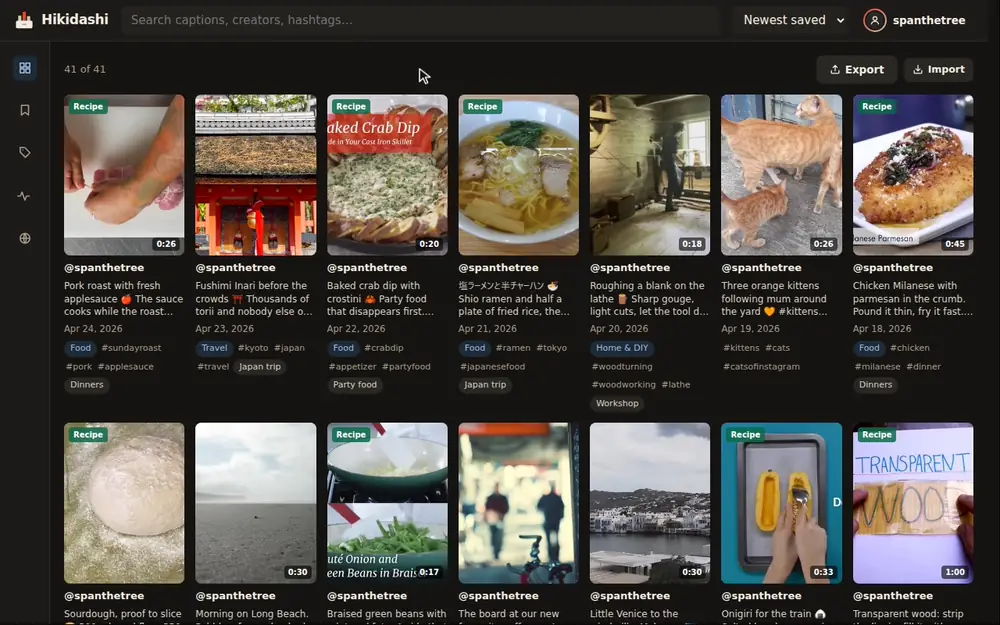
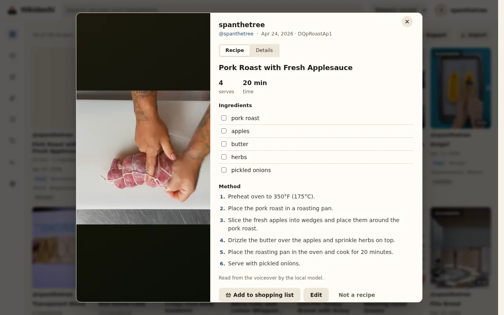
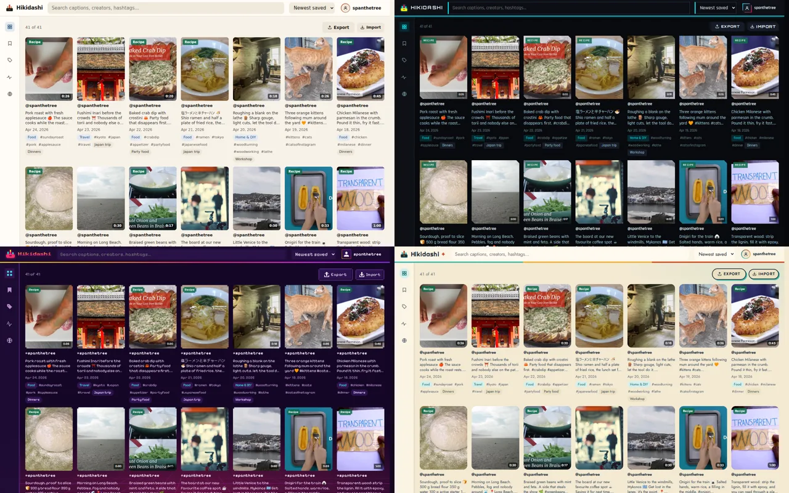
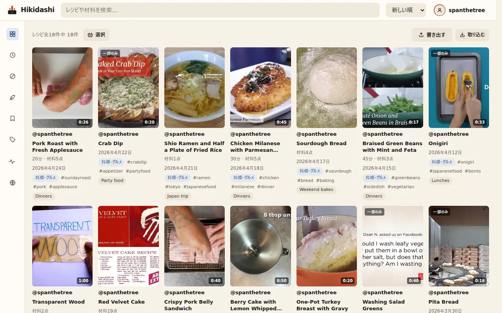

<div align="center">

<picture>
  <source media="(prefers-color-scheme: dark)" srcset="docs/brand/wordmark-dark.svg">
  
</picture>

**A searchable, self-hosted library for your Instagram saves.**

[](https://github.com/spanthetree/hikidashi/releases)
[](https://github.com/spanthetree/hikidashi/actions/workflows/tests.yml)
[](LICENSE)

**English** · [日本語](README.ja.md)

[Getting started](#getting-started) ·
[Documentation](docs/README.md) ·
[FAQ](docs/faq.md) ·
[Changelog](CHANGELOG.md) ·
[Contributing](CONTRIBUTING.md)

</div>

Instagram's Saved tab can't find a reel by what it says or shows. Hikidashi
imports your data export, keeps a copy of every reel, and indexes what each
one says, shows on screen and is about, so you can find the one you half
remember. It runs on your own machine, with local models.



<sub>Recorded on a demo library of freely licensed media ([credits](docs/demo/CREDITS.md)). There is also a [longer tour](docs/demo/tour.mp4).</sub>

## Features

- **Search by meaning.** Captions, transcripts
  ([faster-whisper](https://github.com/SYSTRAN/faster-whisper)) and on-screen
  text (Tesseract) are searched by keyword and by meaning together: "a
  vegetarian sandwich" finds a reel captioned *Portobello banh mi*.
- **Tags and summaries.** A local model ([Ollama](https://ollama.com)) files
  each reel under a category and summarises it. Gaming reels also get the
  game they show. Your own edits always take precedence.
- **Recipes.** Recipe reels become ingredient lists and steps, filterable by
  time and ingredient, with a shopping list that merges recipes by aisle.
- **Places on a map.** Restaurants, shops and viewpoints named in captions are
  collected on a map, optionally geocoded.
- **Your own copy.** Videos and thumbnails are downloaded, so a save outlasts
  the original post.
- **Exports.** Recipes to Mealie, Tandoor and Paprika; the library as an
  Obsidian vault, JSON or CSV.
- **Multiple users.** Each person gets a private library on one server, with
  API tokens for scripts and a browsable API explorer at `/api/docs`.
- **Automatic processing.** New saves are downloaded and analysed in the
  background. The heavy stages can run on a separate machine with a GPU, or,
  if you switch it on, on a hosted AI API (OpenAI, Groq, Mistral, Gemini or
  any OpenAI-compatible server), from the settings page or `hikidashi ai`.
- **English and Japanese**, light and dark themes.

| | | |
|---|---|---|
|  |  |  |
| A recipe read from the voiceover | Four themes, and pixel art | The interface in Japanese |

## Privacy

Your library stays on your machine. Hikidashi contacts Instagram only to
download the posts you saved, and downloads model weights once. The map, if
you turn it on, sends place names to a geocoder and loads map tiles; both can
be self-hosted. It never asks for your Instagram password.

Hosted AI is optional and off by default. If you, or the admin, switch an API
on (OpenAI, Groq's free tier, or any OpenAI-compatible server of your own),
the reels it processes have their audio, a few frames and their text sent to
that provider. Keys are encrypted at rest and never shown again. See
[what is sent where](docs/operation.md#hosted-ai).

## Getting started

**1. Request your export.** In Instagram's Accounts Centre, open
[Export your information](https://accountscenter.instagram.com/info_and_permissions/dyi/)
and create an export to your device: **Saved** only, **All time**, format
**JSON**. It usually arrives within the hour.

**2. Start Hikidashi** with Docker:

```bash
git clone https://github.com/spanthetree/hikidashi.git && cd hikidashi
./hikidashi --docker start --ai
```

This pulls the published images and starts the server, the background
workers and Ollama. To run from source with uv instead, see
[Installing](docs/install.md#with-uv).

**3. Import.** Open <http://localhost:8080> and drop the export ZIP on the
page. Captions are searchable right away; transcripts, tags and recipes fill
in as the workers get through the library.

### On a NAS

- **Unraid:** templates or Compose Manager. See [Installing on Unraid](docs/install-unraid.md).
- **TrueNAS SCALE:** one YAML file. See [Installing on TrueNAS SCALE](docs/install-truenas.md).

### On a low-power device

A small NAS or an ARM board can run the server on its own, without the
worker container or Ollama. Put this line in a `.env` file in the checkout, then
start without `--ai`:

```bash
COMPOSE_FILE=docker-compose.yml:docker-compose.server-only.yml
```

```bash
./hikidashi --docker start
```

The server still downloads new reels and makes them searchable by caption and
by meaning. Transcripts, on-screen text, tags and recipes come from a worker
on another machine, ideally one with a GPU, whenever it runs: see
[Remote workers](docs/remote-workers.md). Or switch on a hosted API, on
**Account → AI providers**, and the server's own worker sends them to it
([hosted AI](docs/operation.md#hosted-ai)).

### Requirements

Docker with Compose, or Python 3.12, uv, FFmpeg and Node 22.17 or later to
run from source. A CPU is enough; an NVIDIA GPU makes transcription and
tagging much faster ([hardware profiles](docs/pipeline.md#hardware-profiles)).

## Documentation

| | |
|---|---|
| [FAQ](docs/faq.md) | Passwords, privacy, hardware, languages |
| [Installing](docs/install.md) | Docker or uv, importing, updating |
| [Using Hikidashi](docs/using.md) | Search, recipes, the map, the pipeline page |
| [Configuration](docs/configuration.md) | Every setting and its default |
| [Accounts and access](docs/accounts.md) | Multiple users, sign-in proxies, API tokens, HTTPS |
| [Exports](docs/export.md) | Recipe managers, Obsidian, JSON and CSV |
| [Remote workers](docs/remote-workers.md) | Running the heavy stages on another machine |
| [The pipeline](docs/pipeline.md) | What each processing stage does |
| [Architecture](docs/architecture.md) | How the system fits together |

All of it is in [docs/](docs/README.md).

## Status

Hikidashi is in active development, before 1.0. Each release migrates the
database on its own, and the [changelog](CHANGELOG.md) notes anything that
needs care when upgrading. Importing still
starts from a manual Instagram export; continuous sync is
[on the list](https://github.com/spanthetree/hikidashi/issues/9).

## Contributing

Bug reports, ideas, translations and pull requests are welcome. See
[CONTRIBUTING.md](CONTRIBUTING.md) to get started, and report security issues
privately as described in [SECURITY.md](SECURITY.md).

## License

Hikidashi is source-available under the
[PolyForm Noncommercial License 1.0.0](LICENSE): free to use, modify and share
for any noncommercial purpose, including personal use, research, and
nonprofit and public organisations. Commercial use needs a separate license. Why this license: [decision record 0016](docs/adr/0016-polyform-noncommercial.md).

The models and programs it uses keep their own licenses, some of them
noncommercial: see [THIRD_PARTY.md](THIRD_PARTY.md).

Hikidashi is not affiliated with, endorsed by or sponsored by Instagram or
Meta.
