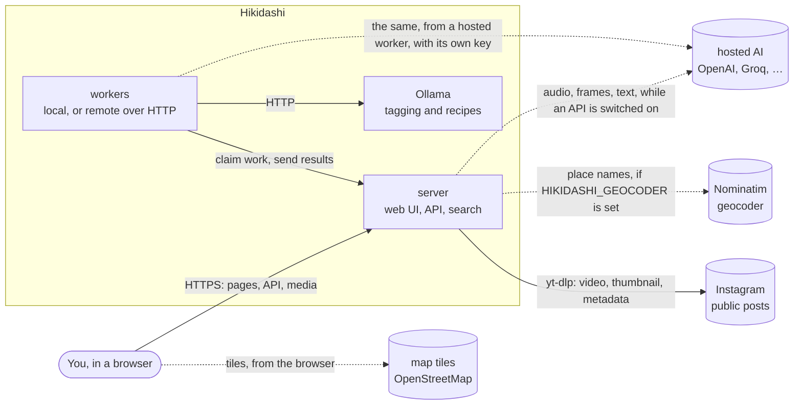
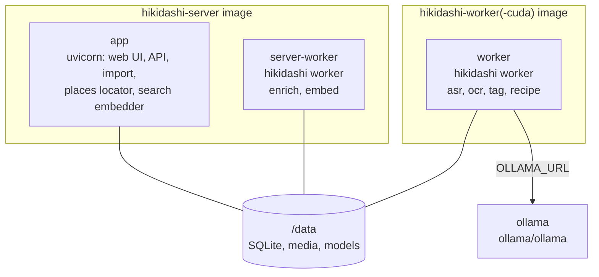
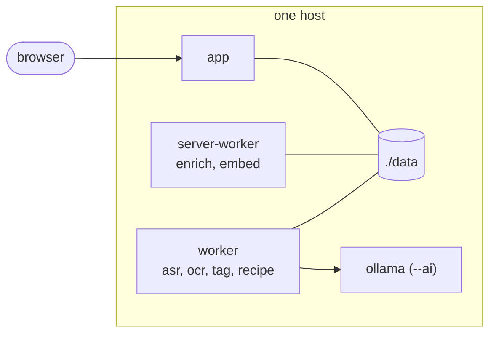
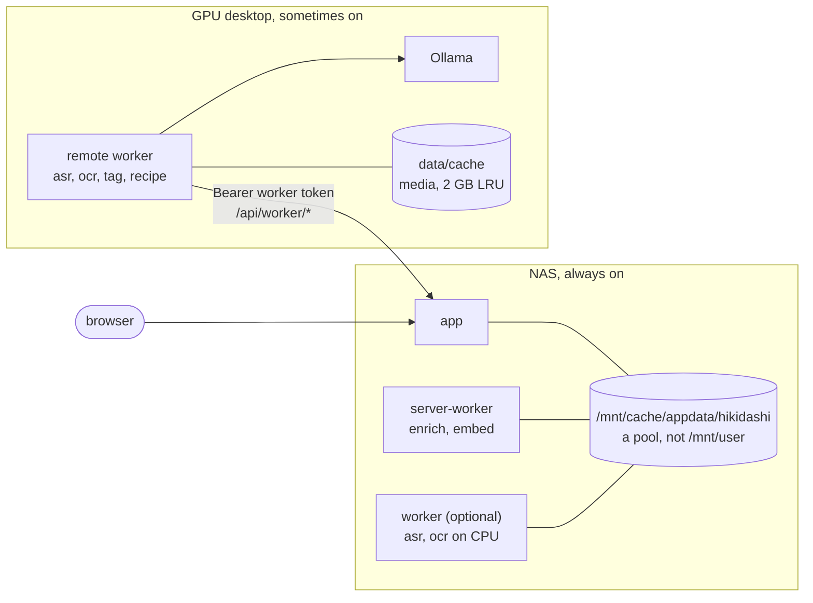
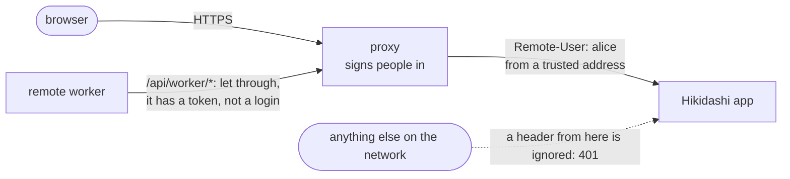
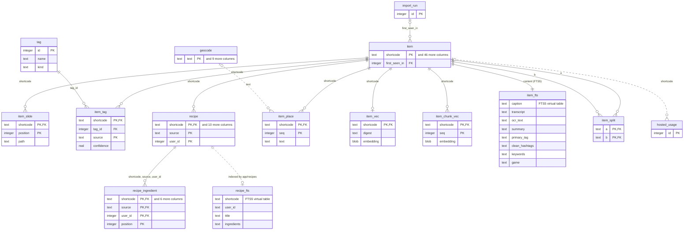
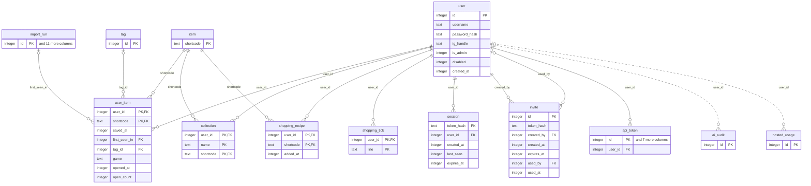
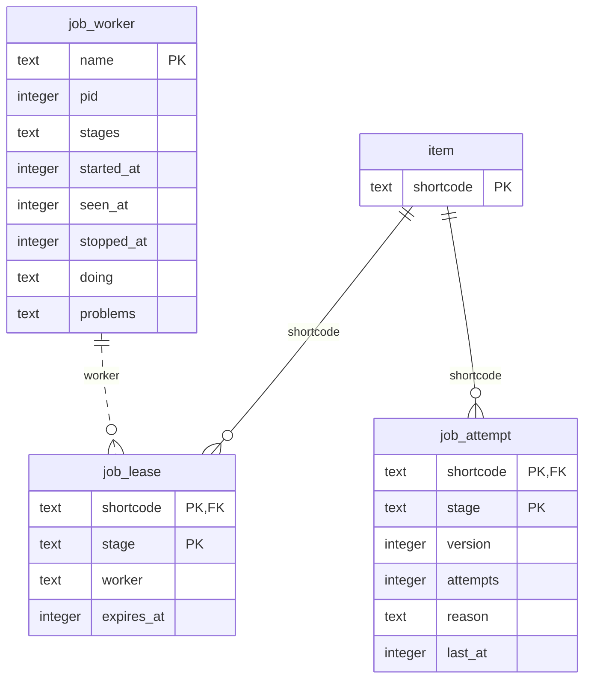
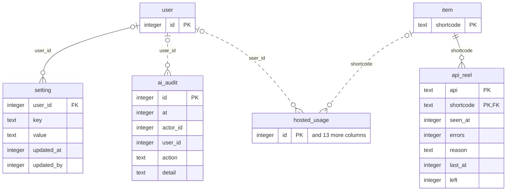
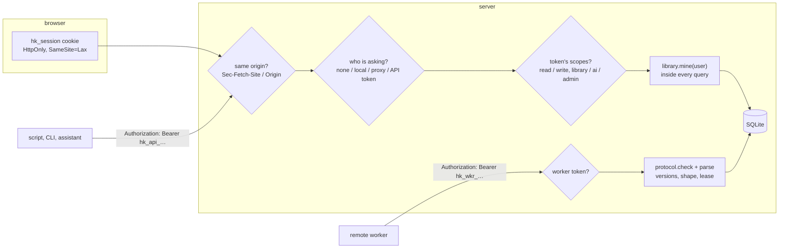

# Architecture

The system from the top down: what talks to what, which image runs which
part, where the data lives, and where the trust boundaries are. How it behaves
at runtime is in [operation.md](operation.md), and why it is built this way in
the [decision records](adr/README.md).
[Back to the README](../README.md)

- [Context](#context)
- [Containers and images](#containers-and-images)
- [Deployment topologies](#deployment-topologies)
- [Data model](#data-model)
- [Storage layout](#storage-layout)
- [Security boundaries](#security-boundaries)

## Context

Hikidashi is one server with one SQLite file, and workers that make what
search needs out of each reel. Everything heavy runs on your own hardware,
unless someone switches a hosted AI API on. Four things leave the machine,
and three of them only if you configure them.



| Outside | Who calls it | What goes out | Off by |
|---|---|---|---|
| Instagram, through yt-dlp | the server's enrich stage | a permalink. No login, no cookies: public posts only | not enriching (`HIKIDASHI_LOCAL_STAGES` without `enrich`) |
| A Nominatim geocoder | the server's places locator | the place names read from captions | default: `HIKIDASHI_GEOCODER` is empty |
| Map tiles | your browser, on the map view | the tile coordinates you look at | `HIKIDASHI_TILES` pointing at your own |
| Hosted AI providers (#116, #125) | the server's worker, for each API that is switched on; or a hosted worker on another machine | a reel's audio (transcription), its cover and five frames (on-screen text), and its caption, hashtags, transcript and on-screen text (tags and recipes) | default: every switch is off, and env never turns one on ([ADR 0019](adr/0019-hosted-ai-behind-a-switch.md)) |

Installing and updating under Docker pulls the images from GitHub's
registry, `ghcr.io/spanthetree` ([#77](https://github.com/spanthetree/hikidashi/issues/77)): an image pull, with nothing of your
library in it. `--build` and a `HIKIDASHI_VERSION` nobody published build
from the checkout instead.

Ollama is part of the system, not outside it: it runs on the server
(`./hikidashi start --ai`) or on the machine of the worker that calls it. The
server itself never calls Ollama ([#86](https://github.com/spanthetree/hikidashi/issues/86)).

## Containers and images

Two images built from one `Dockerfile`, plus the upstream Ollama image ([#86](https://github.com/spanthetree/hikidashi/issues/86)).
Each release publishes them to `ghcr.io/spanthetree`
(`.github/workflows/release.yml`, [#77](https://github.com/spanthetree/hikidashi/issues/77)): the server and worker images for
amd64 and arm64, the cuda one for amd64. The compose files pull them, and
build from the checkout only with `--build` or when there is nothing to
pull.
A worker in either Hikidashi image runs the stages that image has the tools
for, and `HIKIDASHI_LOCAL_STAGES` picks among them.



| Image | What is in it | Runs | `HIKIDASHI_LOCAL_STAGES` default |
|---|---|---|---|
| `hikidashi-server` | FastAPI and uvicorn, the built front end, yt-dlp and ffprobe, the embedder (fastembed), sqlite-vec | `uvicorn` as `app`, `hikidashi worker` as `server-worker` | `enrich,embed` |
| `hikidashi-worker` | faster-whisper, ffmpeg, tesseract. No web stack, no embedder | `hikidashi worker` | `asr,ocr,tag,recipe` |
| `hikidashi-worker-cuda` | the worker, plus the cuBLAS and cuDNN wheels | `hikidashi worker` | `asr,ocr,tag,recipe` |
| `ollama/ollama` | the models `tag` and `recipe` call | Ollama | n/a |

Embed belongs to the server because search embeds every query with the same
model, and a vector from any other model would be silently wrong
([ADR 0003](adr/0003-embedding-is-server-only.md)). Enrich belongs to the server
because it writes the media files the server serves. The worker image's
stages are exactly those a remote worker may run (`protocol.REMOTE`).

Under uv, without Docker, there is one environment and `./hikidashi start`
runs the server and one worker with `HIKIDASHI_LOCAL_STAGES=all`.

## Deployment topologies

Which stages run where is the operator's choice, made with
`HIKIDASHI_LOCAL_STAGES` and nothing detected
([ADR 0004](adr/0004-stages-placed-by-local-stages.md)). Readiness does not care
where a stage runs, so every layout below uses the same queue.

### One box

`docker-compose.yml` on one host: everything, here.



### An always-on server and a sometimes-on GPU desktop

The server on a NAS (Unraid, TrueNAS SCALE) or a small VM, and a desktop with a
GPU that works for it when it is on. The desktop has no database: it claims
reels over HTTP, downloads their media, and posts results
([remote workers](remote-workers.md)).



While the desktop is off, new reels are fetched and embedded from their
captions, so they are searchable at once; transcripts and summaries arrive when
it comes back, and each re-embeds its reel. The NAS's own `worker` container is
optional: with `HIKIDASHI_LOCAL_STAGES=asr,ocr` it transcribes slowly on CPU in
the meantime, or `docker-compose.server-only.yml` leaves it out.

On a NAS these are installed from the published images, not a checkout: one
Unraid template per container, or one compose file pasted into TrueNAS
SCALE's *Install via YAML* ([Unraid](install-unraid.md),
[TrueNAS SCALE](install-truenas.md),
[ADR 0012](adr/0012-nas-installs-templates-and-yaml.md)). The containers meet
only in `/data`, so templates need no shared network or start order, only the
same host path at `/data` in each. They run as the NAS's user (`--user
99:100`, `user: "568:568"`), so appdata isn't root-owned.

### Behind a signing-in proxy

`HIKIDASHI_AUTH=proxy`: a proxy (Authelia, Tailscale, Cloudflare Access) signs
people in and names them in a header. Hikidashi believes the header only from
`HIKIDASHI_TRUSTED_PROXIES`.



Set `HIKIDASHI_ORIGIN` to the address browsers use, so the cross-site check and
the `Secure` cookie flag see the proxy's scheme and host rather than its own.

A script with an API token needs no login either: let `/api/` through for a
request with an `Authorization: Bearer` header, and it reaches the app with no
user header, where the token says who it is. A user header from the proxy, if
there is one, wins over the token.

## Data model

`item` is a shared cache keyed by shortcode: everything derived from a reel
depends only on the reel, so it is made once, whoever saved it. What belongs to
a person is `user_item` and what hangs off the user
([ADR 0005](adr/0005-local-accounts-no-instagram-login.md),
[design.md](design.md#principles)).

These diagrams are generated from `app/schema.sql` by
`scripts/make_diagrams.py`, and CI fails when they drift. Wide tables show
their keys; the schema has every column, with a comment on each.

### Reels and what is made from them

<!-- make_diagrams: er-reels -->

<!-- /make_diagrams -->

A reel's reposts (#58) are grouped by `item.dup_of`, which points at the
earliest saved copy of the same video; `item.phash` is the fingerprint they
were matched by, and `item_split` the pairs someone said are not the same.
The embed stage makes the fingerprints, since it runs on the server with the
media ([app/dupes](../app/dupes/__init__.py)).

### People and their libraries

<!-- make_diagrams: er-people -->

<!-- /make_diagrams -->

### The job queue

<!-- make_diagrams: er-jobs -->

<!-- /make_diagrams -->

### Hosted AI

Settings for each user's own API and the server's (keys encrypted), the
audit log, what each API knows of a reel (when it first found it ready, for
the grace period; its API errors; the backlog it left to workers), and what
every hosted request used, with its cost. How the switch, the claims and the
loose rule work is in [operation.md](operation.md#hosted-ai), and why in
[ADR 0019](adr/0019-hosted-ai-behind-a-switch.md).

<!-- make_diagrams: er-ai -->

<!-- /make_diagrams -->

A few things the diagrams can't show:

- **Provenance as rows.** `item_tag` and `recipe` hold one row per source
  (`hashtag`, `model`, `game`, `user`), so re-running a source replaces only
  its own row. A reel shows the saver's tag, else the game pass's (Gaming, for
  a sure video game on a reel the others filed elsewhere), else the model's,
  else the hashtags'. `item.primary_tag` is kept by triggers so it can be
  indexed for search.
- **The game a reel shows** ([#117](https://github.com/spanthetree/hikidashi/issues/117)) is `item.game` when the tagger is sure of
  it, and indexed; `item.game_guess` when it is not, to ask about; and
  `user_item.game` when its saver has said, `''` meaning none. Like the tag,
  a person's answer is theirs alone and outranks the pass's.
- **Stage stamps.** `item` carries `fetch_v`, `asr_v`, `ocr_v`, `tag_v`,
  `hashtag_v`, `embed_v`, `recipe_v` and `place_v`, plus the profile that made
  each. A stage's pending work is whatever is stamped below its current
  version.
- **Vectors are plain tables.** `item_vec` and `item_chunk_vec` are BLOBs of
  float32, scanned with sqlite-vec's `vec_distance_cosine`. No `vec0` index:
  the schema has to apply on a connection with no extension loaded, and at
  this size a brute-force scan takes a millisecond.
- **`item_fts`** is an external-content FTS5 table over `item`, kept by
  triggers. **`recipe_fts`** is written by `app/recipes/service.py`, since a
  row needs its ingredient list.

## Storage layout

Everything Hikidashi keeps is under one folder: `./data` under uv, `/data` in
the containers (`HIKIDASHI_DATA` on the host). Each path has its own variable.

```
data/
  hikidashi.sqlite3       HIKIDASHI_DB       the database; -wal, -shm and -init.lock beside it
  media/                  HIKIDASHI_MEDIA    about 10 MB a reel, most of the space
    thumbs/                                  thumbnails and carousel slides, sharded by shortcode
    video/                                   the original mp4s, never re-encoded
  imports/<user id>/      HIKIDASHI_IMPORTS  the export ZIPs, one folder per person
  models/                 HIKIDASHI_MODELS   Whisper and embedder weights, 1.5–3 GB
  logs/                   HIKIDASHI_LOGS     server.log, worker.log, server-worker.log
  run/                    HIKIDASHI_RUN      pidfile, pipeline lock, worker.wake
  cache/                  HIKIDASHI_CACHE    a remote worker's downloaded media only
  secret.key                                 encrypts saved API keys (0600), unless HIKIDASHI_SECRET_KEY
```

`secret.key` is outside the SQLite file on purpose: a copy of the database
alone can't read the hosted AI keys saved in it. A backup of all of `data/`
holds both, and can. Lose it and nothing else is lost: the saved keys read as
missing and are entered again.

**It must be on a local disk.** SQLite locks its file through the filesystem,
and NFS, SMB and FUSE shares don't keep those locks reliably. With the server
and two workers writing at once, a database on one can be corrupted. On Unraid
that rules out `/mnt/user/...`, which is FUSE even when it maps to the cache:
use `/mnt/cache/appdata/hikidashi` or another pool. On TrueNAS SCALE, use a
dataset on the host, not a share mounted from elsewhere.

Everything in it belongs to the user the containers run as: root by default,
or the NAS's user given with `--user` or `user:`. That user has no home, so
`HOME` is `/tmp`, and nothing that lasts is written outside `/data`. Every
container on one library has to run as the same user.

A remote worker's `data/` holds only `models/` and `cache/`, and any disk will
do, because there is no SQLite on it.

`hikidashi.sqlite3-init.lock` makes opening the database one process at a
time: the schema and migrations are many statements, and on a first start
every container opens a new database at once ([#87](https://github.com/spanthetree/hikidashi/issues/87)).

`run/worker.wake` is how an import wakes the workers: a file's mtime, because
it crosses processes and containers that share the folder, where a signal or a
socket wouldn't.

## Security boundaries



**Hosted AI keys** (#125). A user's own key is theirs alone: an admin can
see whether one is saved, and remove it (which turns that user's switch
off), but never read or set it. Keys are encrypted at rest, write-only (a
`GET` returns `sk-…abcd`), and kept out of logs, `repr`, errors and every
response by `app/providers/keys.py`. The server never sends a key to a
worker: a hosted worker brings its own. API tokens need the `read:ai` or
`write:ai` scope for these routes, and a worker token can't reach them.

**What a remote worker can make true.** It sends what its model said; the
server records it with the stage's own `record`. For a reel's game that means
the server, not the worker, checks the title against the reel's text, so a
worker can at most leave a suggestion that the reel's saver turns down.

**Per-user scoping.** Every read goes through `user_item`, inside each query
(`library.mine`) rather than filtered after, search lists included. A reel
outside your library is a 404 everywhere, media included: never a 403, which
would say it exists. `/media/<path>` checks the path belongs to a reel you saved
before serving it, and marks it `Cache-Control: private`.

**Who is asking** depends on `HIKIDASHI_AUTH`:

| Mode | Who a request is |
|---|---|
| `none` | user 1, always. One code path, so this is the same scoping with one person |
| `local` | the user whose session the `hk_session` cookie names. Passwords are argon2; there is no sign-up, only an admin's one-time invite link |
| `proxy` | the user the proxy names in `HIKIDASHI_PROXY_HEADER`, believed only from `HIKIDASHI_TRUSTED_PROXIES` (default: localhost). With `HIKIDASHI_PROXY_CREATES`, a name with no account gets one |
| `local` or `proxy`, from a script | the owner of the API token in `Authorization: Bearer`, held to its scopes. The cookie, and a proxy that names someone, come first |

**Sessions.** The cookie holds a random token. The database keeps only its
SHA-256, so a copy of the database cannot be used to sign in, and deleting a
row signs that browser out. Sessions slide: 30 days from the last day of use.
Invites are stored the same way and last 7 days. Sign-in failures are throttled
per username and per address: 10 in 15 minutes.

**CSRF**, in every mode, including `none`: another site could otherwise post
to a server on your network. Any `POST`, `PUT`, `PATCH` or `DELETE` must say it
comes from this app's own pages (`Sec-Fetch-Site: same-origin`, or an `Origin`
matching the host or `HIKIDASHI_ORIGIN`), or come from no browser at all.
`SameSite=Lax` on the cookie is the second line.

**Proxy header trust.** A header naming the user is believed only from a peer
address inside `HIKIDASHI_TRUSTED_PROXIES`. From anywhere else it is ignored
and the request is a 401, since anyone can send a header.

**API tokens** ([ADR 0013](adr/0013-standard-api-and-worker-tokens.md)).
Anything that is not a browser signs in with `Authorization: Bearer <token>`,
never a token in the URL. A person makes their own on Your account (or `hikidashi
token make`), picks its scopes and a life of 30 days at most, and sees it once;
the database keeps its SHA-256 in `api_token`, as it does a session's. A
token acts as its owner and reads only their library. `read:library` allows
`GET` and `HEAD` there, `write:library` the rest too; `read:admin` and
`write:admin` do the same for admin routes, and count only while the owner is
an admin, checked on every request. Changing a password, signing out
everywhere, and making or revoking tokens need a person signed in: no token
does them. A bad, expired or revoked token is a 401 with `WWW-Authenticate:
Bearer error="invalid_token"`; one without the scope is a 403 with
`error="insufficient_scope"`. Disabling an account revokes its tokens. A
bearer request carries no cookie, so another site cannot make one for you.

**Worker tokens.** A remote worker is not a person: it presents a worker
token, `Authorization: Bearer hk_wkr_…`, which an admin made on the Pipeline
page or with `hikidashi token make --worker`: kept in `api_token` as a hash,
shown once, revocable, and never expiring. A worker token opens
`/api/worker/*` and nothing else, and only while the admin who made it is
still one; an API token, even an admin's, does not open `/api/worker/*`. With
no worker token, `/api/worker/*` is a 404: remote workers are off. The server
takes no token from its own environment. On the worker's machine the token
comes from `HIKIDASHI_WORKER_TOKEN`, or is typed at a hidden prompt; never
from a flag, which shell history and the process list would keep. It is
never logged, and the settings leave it out of their repr.

What a remote worker **can** do:

- claim reels for `asr`, `ocr`, `tag` and `recipe`, and read their rows
- download the video or thumbnail of any reel in the library (a worker works
  on the whole library, not one person's)
- post results for the reels it holds

What it **can't** do:

- write SQL, or see the schema. The server records each result with the
  stage's own `record` function ([ADR 0002](adr/0002-workers-write-through-a-job-source.md))
- claim `enrich` or `embed`, which stay on the server
- write a result for a reel it no longer holds: a result after its lease ran
  out and another worker took the reel is dropped
- write anything outside the result's shape: lengths, types, ranges and the
  taxonomy are checked before anything is recorded, and a bad batch is
  refused whole (422)
- work on another release: a stage version or protocol mismatch is a 409,
  and the worker stops
- read anyone's library, accounts or sessions. Its token opens
  `/api/worker/*` and nothing else
