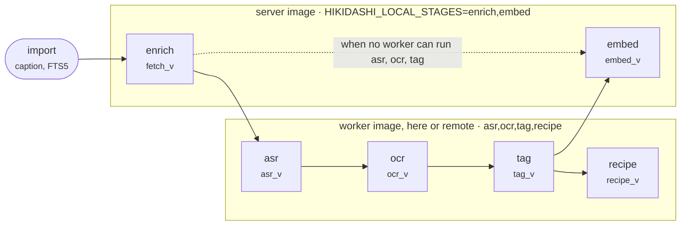
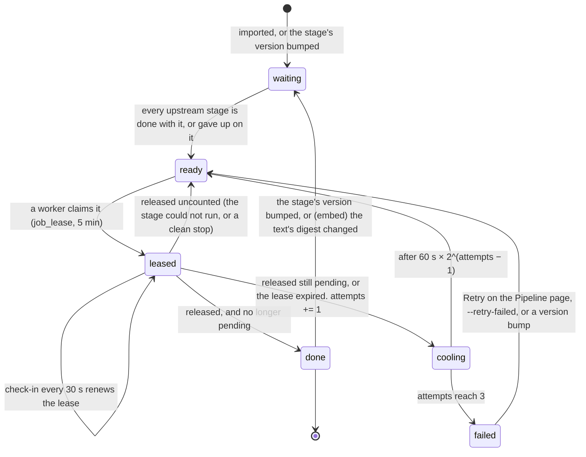
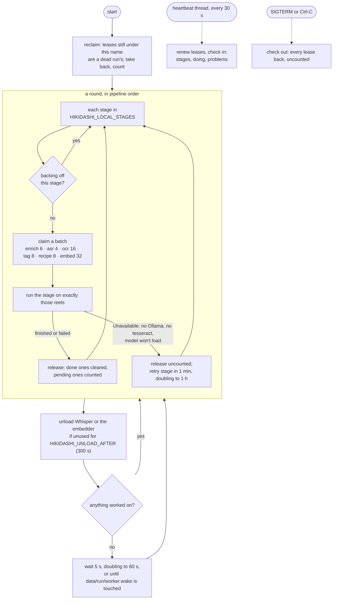
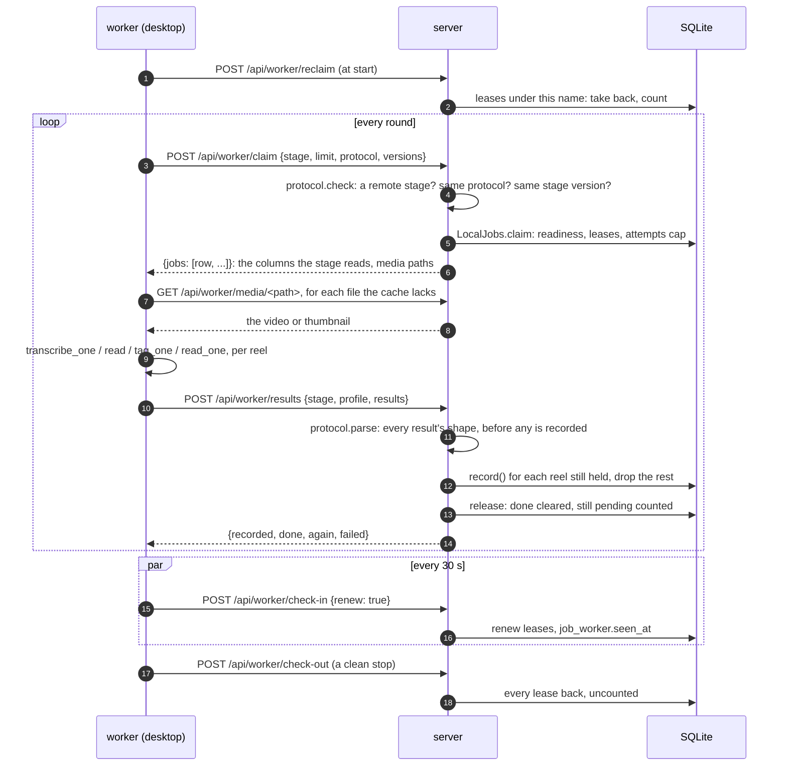
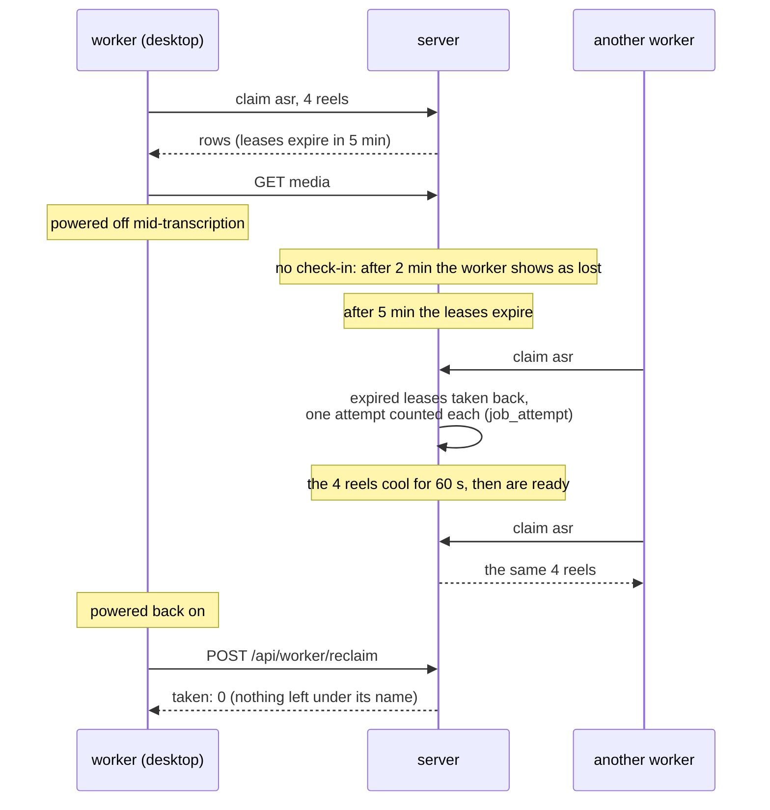
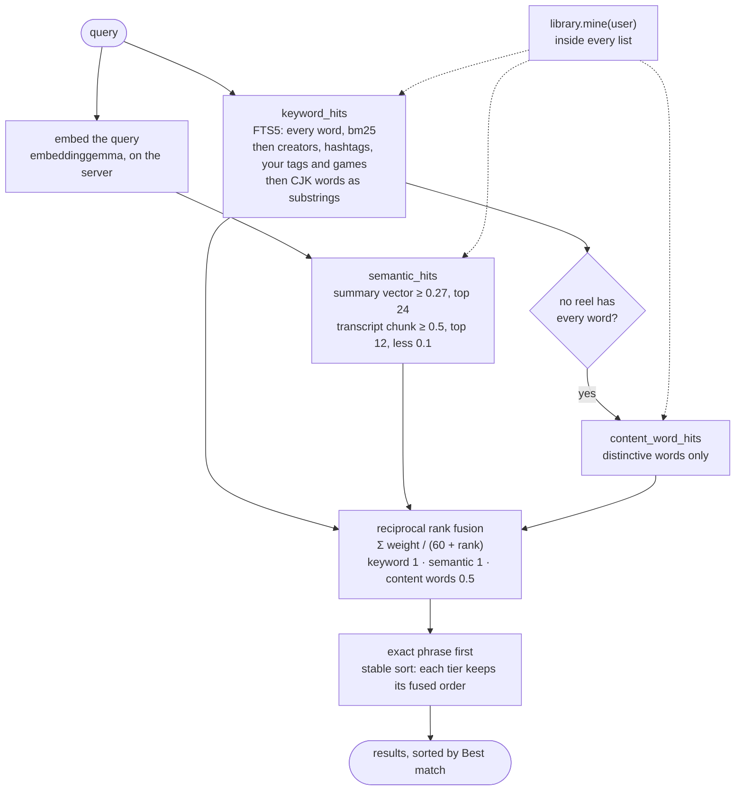
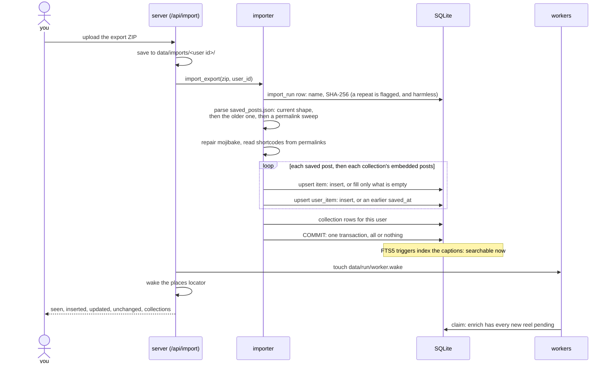
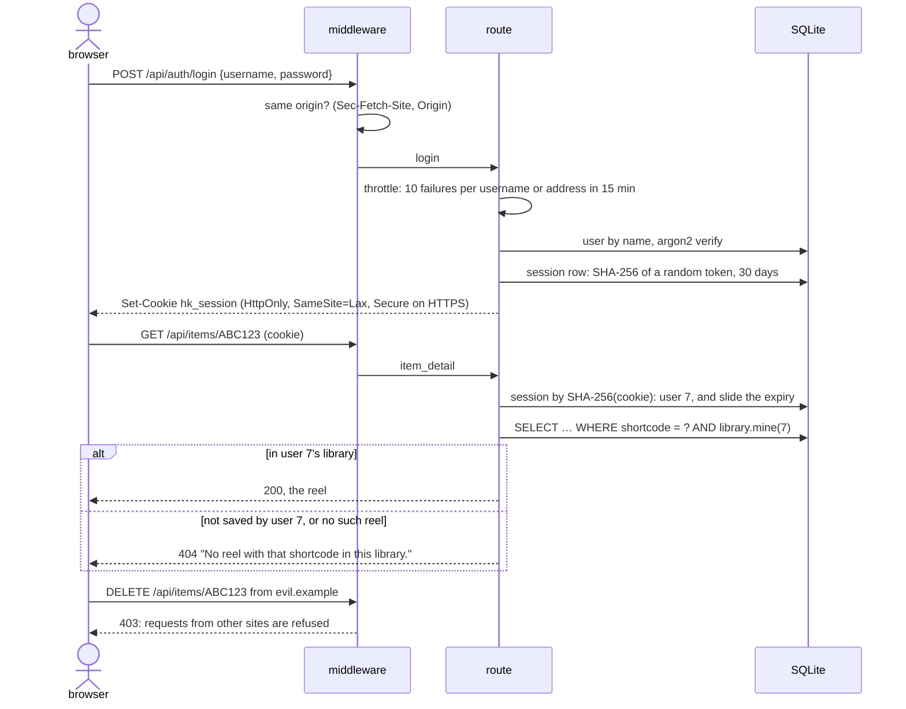
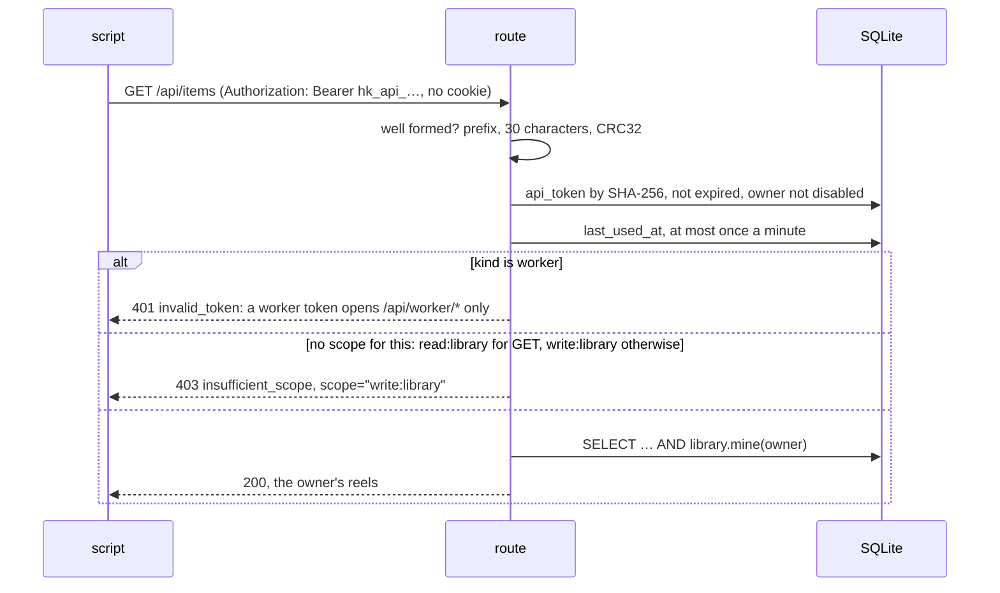

# Operation

How Hikidashi behaves at runtime: a reel's life through the stages, the worker
loop, the remote worker protocol, a search, an import and a signed-in request.
The parts and where they run are in [architecture.md](architecture.md); each
stage's own detail is in [the pipeline](pipeline.md).
[Back to the README](../README.md)

- [Reel lifecycle](#reel-lifecycle)
- [The worker loop](#the-worker-loop)
- [The remote worker protocol](#the-remote-worker-protocol)
- [A search request](#a-search-request)
- [Import](#import)
- [Sign-in and requests](#sign-in-and-requests)

## Reel lifecycle

### The stage graph

Generated from the stage registry in `app/jobs/queue.py`; an arrow is "waits
for". Each node shows the `item` column the stage stamps with its version.

<!-- make_diagrams: stage-graph -->

<!-- /make_diagrams -->

Import is not a stage: it writes `item` and `user_item` directly, and the
caption is searchable from that moment. The hashtag pass is not a stage either:
it is instant and needs no lease, so a local worker runs it before each round
of tagging, and the server runs it when a remote worker asks for reels to tag.
Places are the server's own background job, outside the queue.

OCR waits for ASR because it reads only reels with no speech: a transcript
means there is nothing to OCR. The dashed edge is the embedder going ahead from
captions when no running worker can transcribe, read or tag, so a server whose
heavy stages wait for a desktop still puts new reels in semantic search.

### A reel at one stage

Every stage keeps the same small state machine for each reel, made of the
stage's own pending query and the three job tables.

| State | Where it is | Status calls it |
|---|---|---|
| waiting | in the stage's pending query, and an upstream stage's too | waiting |
| ready | pending, no live lease, not cooling, under the cap | ready |
| leased | a `job_lease` row with `expires_at` in the future | working |
| cooling | a `job_attempt` row under the cap, inside its backoff | waiting |
| failed | a `job_attempt` row at `MAX_ATTEMPTS` (3) for the current version | failed |
| done | no longer in the pending query | (not counted) |

**What decides a re-run.** A stage's work is the rows stamped below its
current version (`fetch_v < FETCH_V`, `asr_v < ASR_V`…), so bumping a version in
code re-runs that stage on everything, and nothing else. Attempts are kept per
version, so a bump also starts every count again. The embedder adds a digest:
`item_vec.digest` is a hash of the text it embedded, so a new summary,
transcript or caption re-embeds that reel alone. That is also how a reel
embedded from its caption alone is embedded again when its transcript and
summary arrive.

**`item.state`** is coarser and older than the queue. It records how far a reel
has come (`imported`, `fetched`, `transcribed`, `tagged`) and only moves
forward. `failed` means the post itself is gone (private, deleted, or a fetch
failed for good): the reel stays as a metadata-only row, because the save is
still a record. A failure at any other stage is `item.fail_stage` and
`fail_reason`, and later stages go on without what it would have made.

A failed fetch is not a `job_attempt` failure, so the stage table never
counts it. The Pipeline page lists those reels on their own, above the
stages' failures, as the sidebar's "failed" counts them. Each one is either
permanent (restricted, deleted, login only: `fetch_v` is stamped, and a
retry can't help) or transient, tried up to `enrich.worker.MAX_ATTEMPTS`
times. Retry there gives only the transient ones that ran out of tries
another round.

## The worker loop

`hikidashi worker`, as `./hikidashi start` and each worker container run it
(`app/jobs/worker.py`).

- **Readiness by stage dependency.** A claim is the stage's pending reels in
  its own order, less those an upstream stage still has to do, those under a
  live lease, those cooling and those at the cap. The claim runs in a
  `BEGIN IMMEDIATE` transaction, so two workers' claims never interleave.
- **Leases and their expiry.** A claim lasts 5 minutes (`LEASE`) and is renewed
  by every 30-second check-in (`HEARTBEAT`), from a thread on its own
  connection, so a long transcription keeps its reels. A lease past its time
  is taken back by the next claim for that stage, and counts as an attempt:
  its worker died holding it. A worker not seen for 2 minutes (`STALE`) shows
  as **lost**; one that checked out shows as **stopped**.
- **Idle and wake-up.** A round with nothing to do waits 5 s, then 10, up to a
  minute. An import touches `data/run/worker.wake`, and every worker on the
  host checks its mtime once a second while it waits, so new reels start
  within a second rather than a minute.
- **Unloading models.** Whisper and the embedder load on first use and are
  dropped after `HIKIDASHI_UNLOAD_AFTER` seconds (300) with no work for them,
  since each holds a gigabyte or more. Ollama unloads its own.
- **A stage that cannot run** is not the reels' fault: it gives them back
  uncounted, is skipped for a minute, then 2, 4… up to an hour, and is
  reported as a problem at every check-in, which the Pipeline page shows.

## The remote worker protocol

A worker on another machine runs the same loop with `HttpJobs` in place of
`LocalJobs`: every claim, release and check-in is a request to the server,
which does the same with its own `LocalJobs`. The server stays the only writer
([ADR 0002](adr/0002-workers-write-through-a-job-source.md)). Setup is in
[remote-workers.md](remote-workers.md).

What the desktop's terminal shows during a real run is in
[remote-workers.md](remote-workers.md#the-desktop-with-uv).

What is checked, and what happens when it fails:

| Check | Where | On failure |
|---|---|---|
| a worker token (`hk_wkr_…`) made on the Pipeline page or with `hikidashi token make --worker`, by an admin who is still one. Not an API token, and not `HIKIDASHI_WORKER_TOKEN` from the server's own environment | `worker_auth` | 401 `invalid_token`, and the worker stops. With no worker token made, 404: remote workers are off |
| the stage is one a remote worker may run (`asr`, `ocr`, `tag`, `recipe`) | `protocol.check` | 409, and the worker stops |
| the same `PROTOCOL`, and the same version of each stage (`ASR_V`, `OCR_V`, `TAG_V`, `RECIPE_V`) | `protocol.check` | 409 naming both versions, and the worker stops: run one release on both |
| the profile is `cpu` or `cuda` | `worker_results` | 422 |
| every result's shape: types, lengths, ranges; a tag the taxonomy lacks is no tag; a tag's game answer is the model's words (kind, title, confidence, others, the check's title), each bounded | `protocol.parse` | 422 for the whole batch, before anything is recorded |
| the worker still holds the reel's lease | `protocol.record` | that result is dropped; another worker has the reel |
| a game is applied only if the reel's text, as the server has it, names it | `tagging.worker.record` | it is kept as a guess to confirm instead: a worker cannot make a title sure |

Embedding is not on this list because it never runs remotely: search embeds
queries on the server, and a vector from a different model would be wrong
without any error to say so ([ADR 0003](adr/0003-embedding-is-server-only.md)).

### When the desktop disappears mid-batch

Results the desktop finished before it went are already recorded: each batch
reports as it ends. A result that arrives late, after another worker took the
reel, is dropped, as the lease check in the table above says. While the server
is unreachable, the worker waits, trying again from 5 s up to a minute, and
its leases run out as if it had died.

## A search request

`GET /api/items?q=…` (`app/search/__init__.py`, `app/api/main.py`). The numbers
and what was tried are in [search.md](search.md).

| Constant | Value | Why |
|---|---|---|
| `K` | 60 | the usual RRF constant. Sweeping 10–60 moved nDCG by under 0.01 |
| `MIN_SIMILARITY` | 0.27 | every reel is a little similar to every query (the median is near 0.1, on-topic reels 0.3–0.5). Without a floor any search returns the library. 0.36 was quieter but cut the reels of a query whose reels never name what it asks for, at 0.27–0.30 |
| `MAX_VECTOR_HITS` | 24 | a vague query is near everything a little, and past this the tail is noise. A fixed count, not relative to the best match, so one fluke at the top can't cut the real answers |
| `MIN_CHUNK_SIMILARITY` | 0.5 | below it, stretches of voiceover outrank reels that are about the query |
| `CHUNK_HANDICAP` | 0.1 | one sentence of speech matching is weaker evidence than the whole reel being about it |
| `CONTENT_WEIGHT` | 0.5 | measured flat from 0.25 to 0.75; at 1, a place query brings up every reel in the place |
| `COMMON` | 0.1 | a word in more than a tenth of the library ("best") doesn't count as distinctive |

The index (FTS5 `item_fts`) holds the caption, transcript, on-screen text,
summary, tag, cleaned hashtags, keywords and, since [#117](https://github.com/spanthetree/hikidashi/issues/117), the game a reel is
sure to show. A guess is not indexed: it is not yet the reel's game. A game
you named is yours, so like your tag it is matched in the second tier rather
than indexed. The filters (`tag`, `game`, `hashtag`, each repeatable, and
`collection`) intersect: a reel must have every one.

Every list is filtered to your library inside its query, not after, so the
caps on the vector lists are spent on reels you can see. Without the embedder,
or while it cannot load, search is keywords only, and the content-word list
settles for any two of the distinctive words when no reel has them all. There is no reranking step:
cross-encoders were measured at +0.02 nDCG for 10–250× the latency, and
rejected ([ADR 0011](adr/0011-hybrid-search-rank-fusion.md)).

## Import

`POST /api/import` from the web, or `./hikidashi import` (`app/importer`).

An import only adds or widens: an existing `item` row has its empty columns
filled and nothing overwritten, a `user_item` row only moves its save time
earlier, and no stage stamp is reset. So re-importing the same export changes
no rows, and a newer export adds only what is new. Every new reel is
`fetch_v = 0`, so it is pending for enrich, and readiness carries it down
from there. The counts are of your library: a reel someone else saved first is
still `inserted` for you, though no new `item` row or download was made.

## Sign-in and requests

`HIKIDASHI_AUTH=local`. Under `none`, the session steps are skipped and the
user is always user 1. Under `proxy`, the user comes from the trusted header
instead of the cookie. The scoping is the same in all three modes.

A 404 rather than a 403 is the point: a 403 would tell you that someone else
has saved that reel. The same check guards `/media/<path>`, so a thumbnail URL
copied from someone else's library is a 404 to you too. Admin routes (users,
invites, everyone's tokens, the Pipeline page) are a 403 for anyone else,
because they are about the server, not a library.

### From a script: an API token

In `local` and `proxy` mode, anything that is not a browser brings an API
token, made on Your account or with `hikidashi token make`
([ADR 0013](adr/0013-standard-api-and-worker-tokens.md)).

| Check | Where | On failure |
|---|---|---|
| a session cookie first (`local`), or the trusted proxy's header (`proxy`); a token only when neither names anyone | `current_user` | the cookie or header wins, and the token is not looked at |
| the token is well formed, known, not expired, and its owner not disabled | `accounts.find_token` | 401 `invalid_token` |
| an API token, not a worker token | `from_token` | 401 `invalid_token` |
| `read:` for `GET` and `HEAD`, `write:` otherwise, of `library` on library routes and `admin` on admin routes | `library_user`, `admin` | 403 `insufficient_scope`, naming the scope |
| `admin` scopes count only while the owner is an admin, every request | `Token.grants` | 403, as if the scope were missing |
| a password, signing out everywhere, making or revoking a token | `by_session` | 403: a token cannot |

The `/api/stats` worker summary and exporting someone else's library are
admin reach inside library routes: a token needs `read:admin` for them too. A
token is never read from the URL, where logs would keep it.
