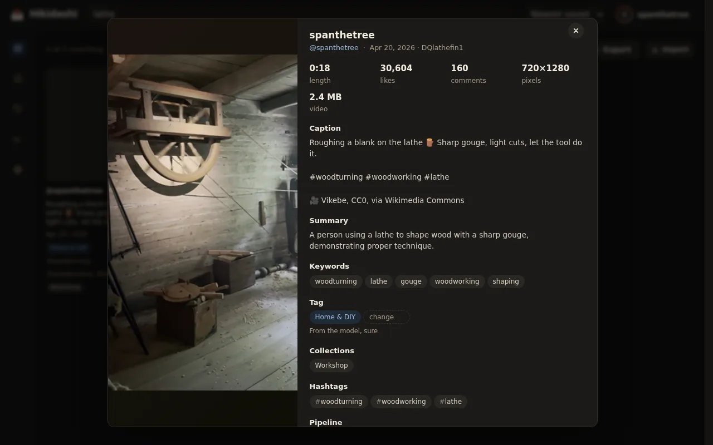
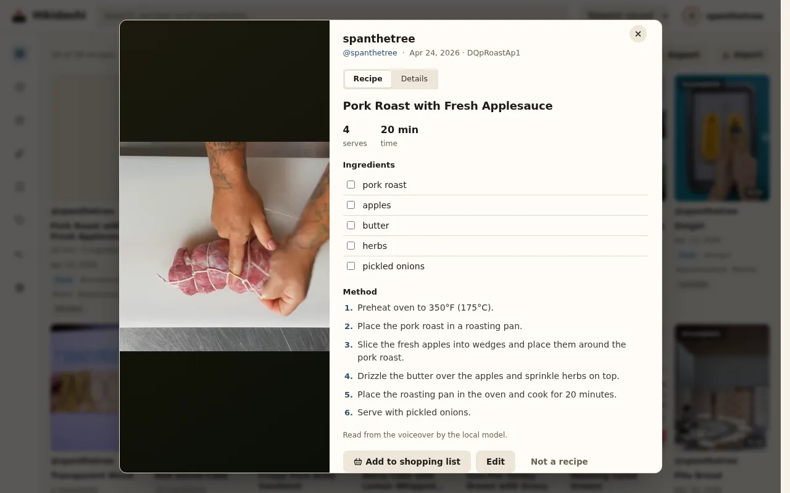
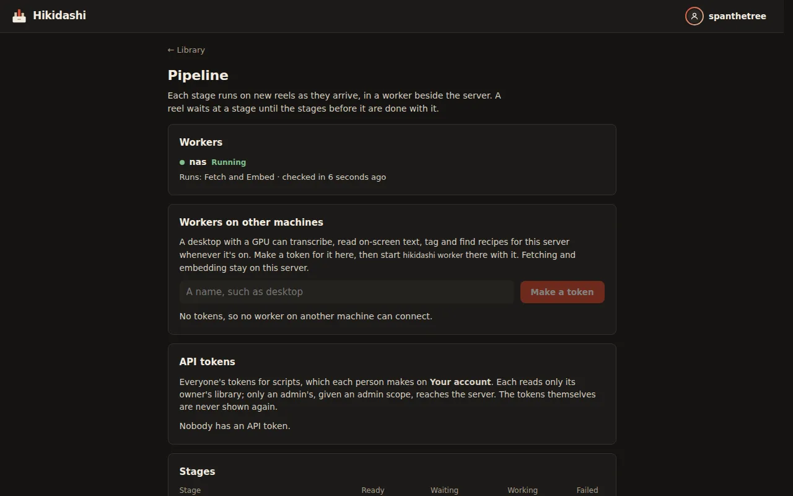
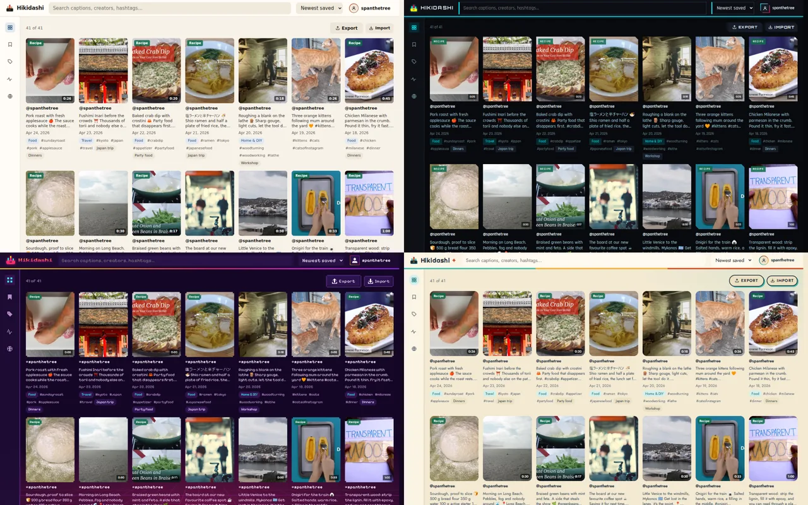
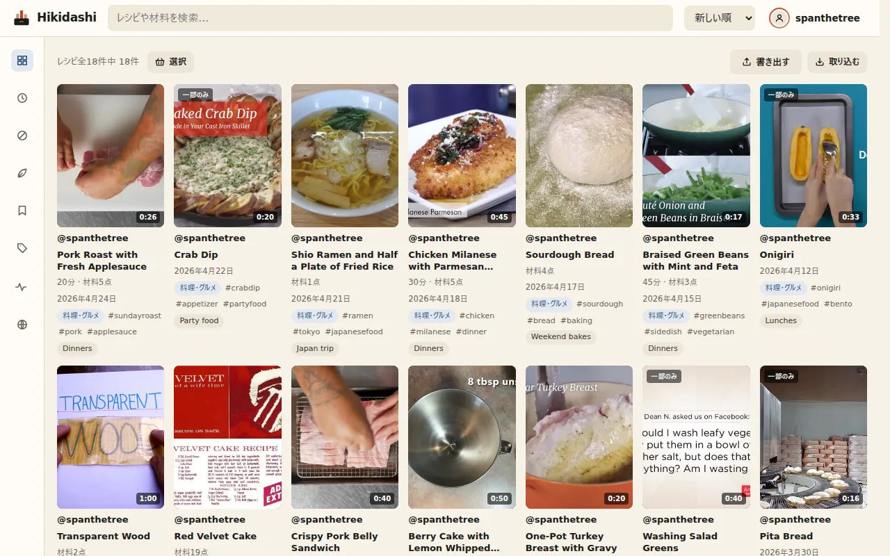

# Using Hikidashi

A tour of the web app. [Back to the README](../README.md)

- [The library](#the-library)
- [A reel](#a-reel)
- [Recipes and the shopping list](#recipes-and-the-shopping-list)
- [Places and the map](#places-and-the-map)
- [The pipeline and logs](#the-pipeline-and-logs)
- [Settings](#settings)

## The library

- **The sidebar** is a rail of icons that opens on hover; the pin at its top
  keeps it open. **Videos** and **Images**, under Library, narrow whatever you
  are looking at (a collection, a tag, Recipes) to reels or to photo posts.
- **Search** matches what a reel says, shows on screen and has in its caption,
  and what it means: "a vegetarian sandwich" finds a reel captioned
  *Portobello banh mi*. [Search](search.md) explains how results are ranked.
- **Filters** by tag, game, collection and hashtag combine with each other and
  with the search; each one you pick narrows the rest. The tags, games,
  collections and hashtags on a reel are links to more of the same.
- **Every view is a URL.** The search, the filters and the open reel are in
  the address bar, so a view can be bookmarked or shared and the back button
  works.
- **Export**, above the grid, downloads what the grid shows
  ([exports](export.md)).

## Rediscover

Above the grid, when nothing is chosen, two strips bring old saves back: **On
this day**, saved on today's date in earlier years, and **Never opened**, the
oldest saves you have not opened here yet. Each hides until tomorrow with its
×. Whether you opened a reel is yours alone; nobody else sees it.

**Shuffle** opens a random reel from whatever the grid is showing, so a
filter or a search narrows it. **Another** in its sheet picks again.

## A reel

Open a reel to watch it (muted and looped) beside its caption, transcript and
on-screen text.



From its sheet you can:

- change its tag. Your choice always wins over the model's, and is never
  overwritten;
- confirm or name the video game a gaming reel shows;
- follow the addresses in its caption to Google Maps;
- read the transcript line by line, once a reel has been transcribed since
  0.25: the line playing lights up, and pressing one plays from there. A
  search that matched what was said opens the reel at that line;
- open one of the reels **More like this**: the closest in meaning in your
  library, from the same vectors as search;
- export it, or copy it as Markdown;
- **Try fetching again**, if its download failed;
- **Remove** it from your library. Anyone else who saved it keeps it; once
  nobody has, its video and thumbnail are deleted.

## Recipes and the shopping list

**Recipes**, in the sidebar, shows only the reels with a recipe, each led by the
dish and how long it takes. Filter by time, by ingredient, or by what a recipe
leaves out: "with chicken, without dairy". Open one for an ingredient
checklist and numbered steps next to the video, with **Add to shopping list**,
**Edit**, **Use the model's version** and **Not a recipe**.



**Select** picks several recipes at once; with a filter on, **Add all** adds
every recipe it shows. **Shopping list**, in the sidebar, merges their
ingredients by aisle, folds away pantry staples, and can be shared or copied
as text.

To cook from a recipe in a recipe manager, export it to Mealie, Tandoor or
Paprika ([exports](export.md#recipes)).

## Places and the map

**Places**, under Library, lists every reel whose caption names a place: an
address, or a 📍 pin. **Map** draws them: pins beside a list that narrows as
you pan, with each reel's thumbnail a click away. **Restaurants** and
**Travel** narrow both to reels tagged Food or Travel. Every filter applies,
so searching "ramen" shows the ramen places, and **Near me**, or a city you
type, sorts them by distance.

The list needs nothing set up. The map needs each place looked up on a
geocoder, which sends the place's text off the machine, so it is off until you
choose one in `.env` and restart:

```bash
HIKIDASHI_GEOCODER=public                  # OpenStreetMap's Nominatim, one place a second
HIKIDASHI_GEOCODER=http://nominatim:8080   # or your own
```

From then on the server looks up the places new reels name as they arrive:
straight away for an import through the web, and within five minutes
(`HIKIDASHI_LOCATE_EVERY`) for one from the command line. `./hikidashi
places` does it on demand, and `HIKIDASHI_GEOCODER=public ./hikidashi places`
tries a geocoder for one run. Under Docker, `localhost` is the container
itself: reach your own Nominatim by its compose service name or
`host.docker.internal`.

Each place is looked up once and remembered. A place the geocoder is unsure of
stays off the map rather than land in the wrong country, and the map says how
many it leaves out.

**Map tiles also leave your machine.** The browser draws the map from
OpenStreetMap's tile servers, which see the area you look at. Set
`HIKIDASHI_TILES` to a tile server of your own to keep that local, and
`HIKIDASHI_TILES_ATTRIBUTION` to the credit its data requires.

Over plain HTTP, browsers don't allow **Near me**; it works over HTTPS and on
`localhost`.

## The pipeline and logs

**Pipeline**, opened from the worker status at the foot of the sidebar, shows
each worker and, for every stage, what is ready, waiting, in progress and
failed, with **Retry** for failures. It is also where an admin makes the
tokens for [workers on other machines](remote-workers.md). **Logs**, from
there, shows the server's and the workers' logs live, filterable to warnings
and errors. With accounts on, both are for admins only.



## Settings

The menu at the top right picks the theme: Hikidashi by default (paper, ink
and vermilion, after the logo), or cyberpunk, retrowave or retrofuture; light,
dark or the system's choice; and pixel art, which redraws any theme, its icons
and the logo in pixels. These are remembered in the browser.



It also leads to **Your account**: your Instagram @handle, your password, API
tokens, the export form and, for admins, invitations and accounts
([accounts](accounts.md)).

The interface is in English and Japanese. It follows the browser's language,
or the switcher at the foot of the sidebar. Japanese searches find Japanese
captions and, through the multilingual embeddings, English reels on the same
subject.


